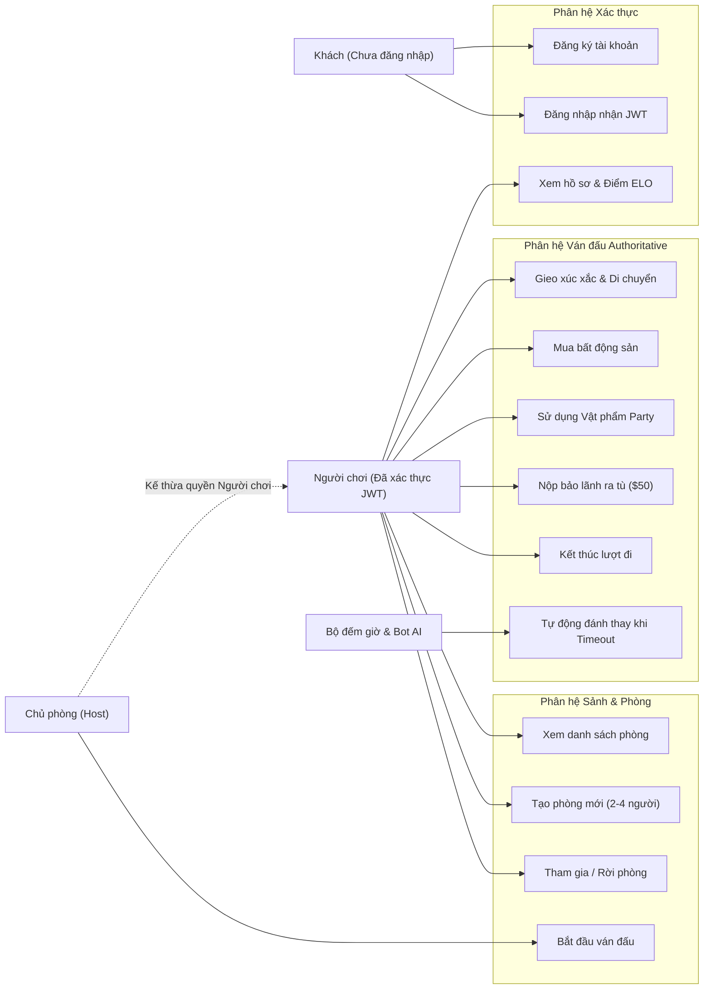
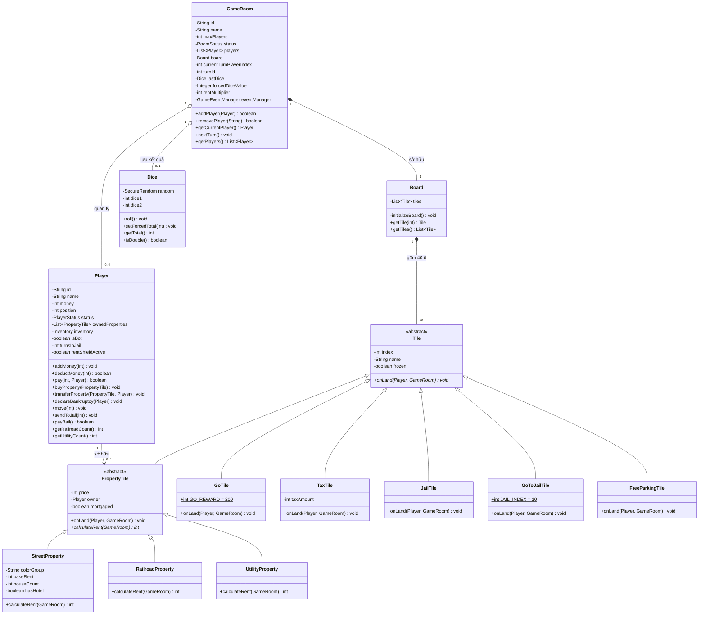
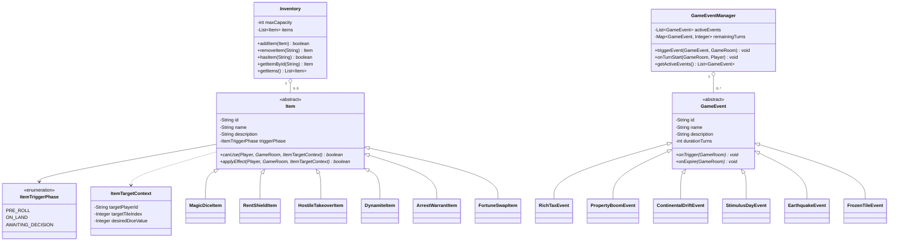
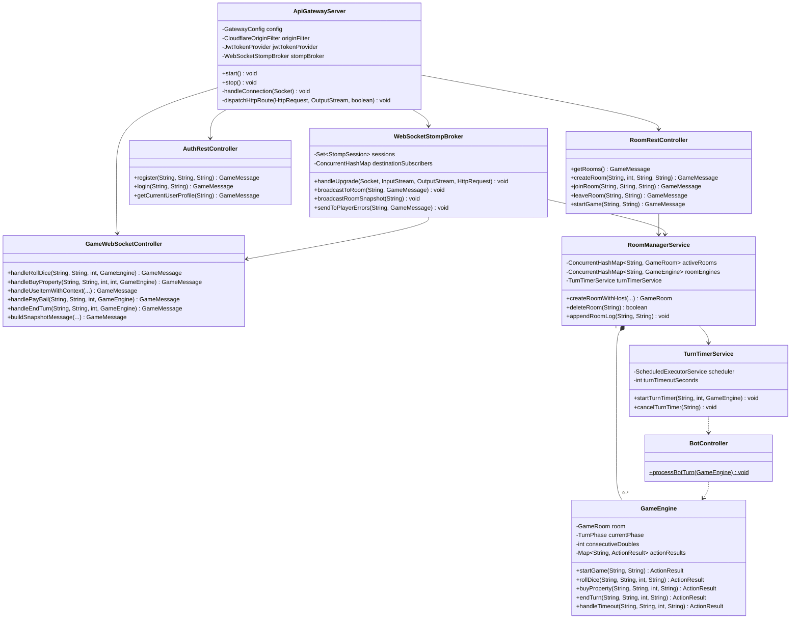
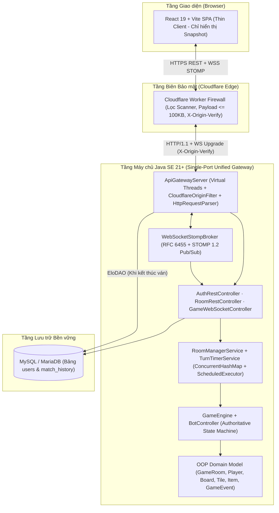
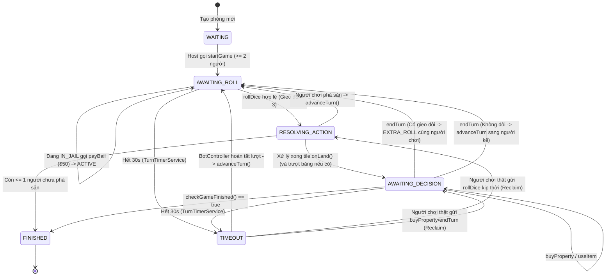
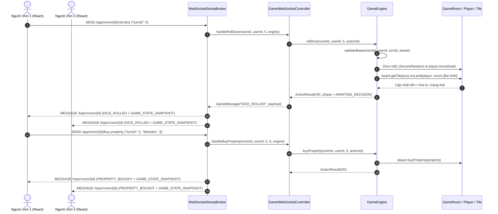
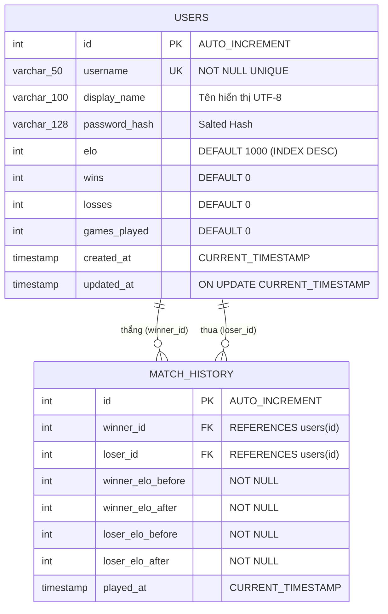

# BÁO CÁO BÀI TẬP LỚN HỌC PHẦN LẬP TRÌNH HƯỚNG ĐỐI TƯỢNG

<div align="center">

**HỌC VIỆN CÔNG NGHỆ BƯU CHÍNH VIỄN THÔNG (PTIT)**  
**KHOA CÔNG NGHỆ THÔNG TIN**

---

### ĐỀ TÀI
# XÂY DỰNG HỆ THỐNG WEBGAME CỜ TỶ PHÚ TRỰC TUYẾN ĐA NGƯỜI CHƠI (MONOPOLY PARTY ONLINE) THEO KIẾN TRÚC AUTHORITATIVE SERVER

**Ngôn ngữ chính**: Java SE (JDK 21+) · React 19 · TypeScript · MySQL/MariaDB  
**Kho mã nguồn**: [github.com/Skyboy12/Monopoly](https://github.com/Skyboy12/Monopoly)

</div>

---

## THÔNG TIN NHÓM THỰC HIỆN & QUY MÔ DỰ ÁN

### 1. Bảng phân công thành viên nhóm

| STT | Họ và tên | Mã sinh viên | Vai trò & Phân hệ phụ trách | Tài liệu & Gói mã nguồn chính |
| :-: | :--- | :---: | :--- | :--- |
| 1 | *(Điền họ tên TV1)* | *(Mã SV)* | Phân tích nghiệp vụ, Thiết kế UML & Hợp đồng giao thức API/STOMP | `docs/development-docs/`, `network/` |
| 2 | *(Điền họ tên TV2)* | *(Mã SV)* | Core Domain OOP, Hệ thống Ô cờ đa hình, Vật phẩm & Sự kiện | `model/`, `model.tile/`, `model.item/`, `model.event/` |
| 3 | *(Điền họ tên TV3)* | *(Mã SV)* | Authoritative Game Engine, Máy trạng thái lượt chơi, Timeout & Bot AI | `engine/`, `engine.bot/`, `TurnTimerService` |
| 4 | *(Điền họ tên TV4)* | *(Mã SV)* | Pure-JDK HTTP/WebSocket STOMP Gateway, Bảo mật JWT & Lưu trữ MySQL | `server.gateway/`, `server.controller/`, `server.security/`, `server.database/` |
| 5 | *(Điền họ tên TV5)* | *(Mã SV)* | Giao diện React Frontend, Tường lửa Cloudflare Edge & Kiểm thử tích hợp | `Monopoly/src/client/`, `cloudflare-firewall/`, `test/` |

### 2. Thống kê quy mô mã nguồn thực tế

| Phân hệ | Công nghệ sử dụng | Số lượng tệp | Quy mô dòng lệnh (LOC) | Đặc điểm kỹ thuật nổi bật |
| :--- | :--- | :---: | :---: | :--- |
| **Backend & Core OOP** | Java SE 21+ (Thuần JDK) | 62 tệp `.java` | ~7.963 dòng | Tự cài đặt HTTP/1.1, JSON Parser, WebSocket RFC 6455, STOMP 1.2, JWT HS256 |
| **Hệ thống Kiểm thử** | Pure-JDK Test Runner | 1 tệp `.java` | ~1.917 dòng | 4 Test Suites (A–D), 16 kịch bản Unit, Concurrency, TCP HTTP & STOMP thật |
| **Frontend Client** | React 19, Vite, STOMP.js | 15 tệp `.jsx/.js/.css` | ~2.570 dòng | Thin Client chuẩn Authoritative, CSS Grid 11×11, bù lệch đồng hồ thời gian thực |
| **Edge Firewall** | Cloudflare Worker (TS) | 1 tệp `.ts` | ~203 dòng | Lọc mã độc, Method/Path Whitelist, Payload $\le$ 100KB, Origin Shielding |
| **Cơ sở dữ liệu** | MySQL / MariaDB (JDBC) | 1 tệp `.sql` + 4 DAO | 2 bảng quan hệ | Lưu tài khoản & lịch sử ELO theo Transaction `SELECT ... FOR UPDATE` |

---

## MỤC LỤC

1. [Chương 1: Tổng quan đề tài & Phân tích yêu cầu](#chương-1-tổng-quan-đề-tài--phân-tích-yêu-cầu)
2. [Chương 2: Phân tích & Thiết kế Hướng đối tượng (Trọng tâm)](#chương-2-phân-tích--thiết-kế-hướng-đối-tượng-trọng-tâm)
3. [Chương 3: Kiến trúc hệ thống, Cơ chế đồng thời & Thuật toán nghiệp vụ](#chương-3-kiến-trúc-hệ-thống-cơ-chế-đồng-thời--thuật-toán-nghiệp-vụ)
4. [Chương 4: Thiết kế Cơ sở dữ liệu & Giao diện người dùng](#chương-4-thiết-kế-cơ-sở-dữ-liệu--giao-diện-người-dùng)
5. [Chương 5: Kiểm thử hệ thống & Đánh giá chất lượng](#chương-5-kiểm-thử-hệ-thống--đánh-giá-chất-lượng)
6. [Chương 6: Hướng dẫn cài đặt, Kết luận & Hướng phát triển](#chương-6-hướng-dẫn-cài-đặt-kết-luận--hướng-phát-triển)

---

## CHƯƠNG 1: TỔNG QUAN ĐỀ TÀI & PHÂN TÍCH YÊU CẦU

### 1.1. Đặt vấn đề và Lý do chọn đề tài

Trò chơi **Cờ Tỷ Phú (Monopoly)** là một bài toán mô phỏng kinh tế – chiến thuật kinh điển có độ phức tạp nghiệp vụ rất phù hợp để áp dụng toàn diện phương pháp **Phân tích và Thiết kế Hướng đối tượng (Object-Oriented Analysis and Design - OOAD)**:

1. **Sự đa dạng về thực thể và phân cấp hành vi**: Bàn cờ gồm 40 ô thuộc nhiều chủng loại khác nhau (đất xây dựng theo nhóm màu, nhà ga, công ty điện/nước, ô thuế, ô xuất phát, nhà tù, bãi đỗ xe...). Nếu lập trình theo hướng thủ tục với các khối `if-else` / `switch-case` khổng lồ, mã nguồn sẽ nhanh chóng trở nên cứng nhắc, khó bảo trì và dễ phát sinh lỗi khi mở rộng thêm vật phẩm hay sự kiện mới.
2. **Thách thức của môi trường trực tuyến đa người chơi (Multiplayer)**: Khi chuyển thể lên nền tảng Webgame thời gian thực cho 2–4 người chơi, hệ thống phải giải quyết triệt để vấn đề **chống gian lận (Anti-Cheat)**, **đồng bộ trạng thái tức thời**, **kiểm soát truy cập đồng thời (Concurrency)** và **xử lý tự động khi người chơi mất kết nối hoặc hết giờ (AFK/Timeout)**.

Xuất phát từ thực tế đó, nhóm lựa chọn xây dựng hệ thống **Monopoly Party Online** bằng ngôn ngữ **Java thuần (Pure JDK)** ở phía máy chủ kết hợp mô hình **Authoritative Server** (Máy chủ nắm quyền quyết định tuyệt đối), không phụ thuộc vào các framework hộp đen bên ngoài (như Spring Boot hay Netty) nhằm làm chủ hoàn toàn kiến trúc hướng đối tượng từ tầng Domain, Game Engine cho tới tầng giao thức mạng HTTP/WebSocket STOMP.

### 1.2. Mục tiêu của hệ thống

- **Mục tiêu học thuật (OOP)**: Thể hiện rõ ràng, sâu sắc 4 trụ cột của Lập trình Hướng đối tượng (**Đóng gói, Trừu tượng, Kế thừa, Đa hình**), các nguyên lý **SOLID** và các **Mẫu thiết kế (Design Patterns)** chuẩn mực thông qua mô hình miền (`model`) tách biệt hoàn toàn khỏi giao diện và tầng mạng.
- **Mục tiêu kỹ thuật**:
  - Máy chủ là nguồn sự thật duy nhất (*Single Source of Truth*): Mọi kết quả xúc xắc (`SecureRandom`), biến động số dư, quyền sở hữu tài sản và chuyển pha lượt đi đều do máy chủ tính toán và kiểm chứng.
  - Phản hồi thời gian thực qua giao thức song công **WebSocket (RFC 6455) + STOMP 1.2** kết hợp **REST API** quản lý sảnh chờ.
  - Mở rộng lối chơi với chế độ **Party Mode** gồm 6 loại Vật phẩm chiến thuật (`Item`) và 6 Sự kiện biến động bàn cờ (`GameEvent`).
  - Triển khai lớp bảo vệ biên mạng **Cloudflare Worker Edge Firewall** kết hợp cơ chế **Origin Shielding**.

### 1.3. Phân tích yêu cầu chức năng (Functional Requirements)

1. **Phân hệ Tài khoản & Xếp hạng (`Auth & Profile`)**:
   - Đăng ký tài khoản mới (hỗ trợ tên hiển thị tiếng Việt UTF-8, mật khẩu băm có muối).
   - Đăng nhập cấp phát mã thông báo **JWT (HS256)** và truy vấn hồ sơ cá nhân cùng điểm xếp hạng ELO (mặc định `1000 ELO`).
   - Tự động tính toán và lưu lịch sử biến động điểm ELO sau khi ván đấu kết thúc.
2. **Phân hệ Sảnh chờ & Phòng chơi (`Lobby & Room Management`)**:
   - Xem danh sách phòng đang mở, lọc theo trạng thái (`WAITING`, `PLAYING`), tạo phòng mới (từ 2 đến 4 người chơi, vốn khởi điểm \$1.500/người).
   - Tham gia phòng qua danh sách hoặc mã phòng (`room-xxxxxxxx`), rời phòng (tự động giải tán phòng khi trống hoặc chuyển quyền Chủ phòng — *Host* cho người kế tiếp).
   - Chủ phòng khởi động ván đấu khi có tối thiểu 2 người chơi.
3. **Phân hệ Luật chơi Cờ Tỷ Phú cốt lõi (`Core Gameplay`)**:
   - Gieo cặp 2 viên xúc xắc 6 mặt; thưởng \$200 khi đi qua hoặc đáp đúng ô `GO` (trừ trường hợp bị áp giải thẳng vào tù).
   - Luật xúc xắc đôi (*Doubles*): Gieo đôi được thêm lượt (`EXTRA_ROLL`); gieo đôi **3 lần liên tiếp** bị tống thẳng vào tù (`THREE_DOUBLES`).
   - Mua tài sản chưa có chủ, thu tiền thuê tự động theo công thức riêng của từng nhóm tài sản (`StreetProperty`, `RailroadProperty`, `UtilityProperty`), khấu trừ thuế tại `TaxTile`.
   - Cơ chế Nhà tù (`JailTile` / `GoToJailTile`): Nộp \$50 bảo lãnh chủ động trước khi tung xúc xắc hoặc bắt buộc nộp sau 3 lượt thụ án.
   - Cơ chế Phá sản (`declareBankruptcy`): Tự động chuyển giao toàn bộ bất động sản và tiền mặt còn lại cho chủ nợ (hoặc thu hồi về Ngân hàng nếu nợ thuế/tiền phạt), kết thúc ván đấu khi chỉ còn 1 người chơi trụ lại.
4. **Phân hệ Party Mode (`Items & Special Events`)**:
   - Quản lý túi đồ cá nhân (`Inventory` tối đa 5 ô) với 6 vật phẩm kích hoạt theo ngữ cảnh mục tiêu (`ItemTargetContext`) và pha lượt đi (`ItemTriggerPhase`).
   - Quản lý vòng đời 6 sự kiện toàn cục và cục bộ (`GameEventManager`) tự động kích hoạt và hoàn tác hiệu ứng theo số lượt quy định.
5. **Phân hệ Đếm ngược & Bot AI (`Turn Timer & Auto-Play`)**:
   - Giới hạn 30 giây mỗi lượt đi; khi hết giờ, hệ thống chuyển sang pha `TIMEOUT` và ủy quyền cho `BotController` tự động thực hiện lượt chơi.
   - Cho phép người chơi thật giành lại quyền điều khiển (`reclaimHumanControl`) ngay lập tức nếu gửi lệnh hợp lệ trước khi lượt kết thúc.

### 1.4. Sơ đồ Use Case tổng quát



---

## CHƯƠNG 2: PHÂN TÍCH & THIẾT KẾ HƯỚNG ĐỐI TƯỢNG (TRỌNG TÂM)

Toàn bộ miền nghiệp vụ của dự án được đặt trong các gói `model.*` và `engine.*`, **hoàn toàn độc lập với giao diện người dùng, cơ sở dữ liệu hay giao thức mạng**. Dưới đây là phân tích chi tiết cách dự án hiện thực hóa 4 tính chất OOP, nguyên lý SOLID và các mẫu thiết kế phần mềm.

### 2.1. Hiện thực hóa 4 Tính chất Cốt lõi của Lập trình Hướng đối tượng

#### 2.1.1. Tính Đóng gói (Encapsulation) & Bảo toàn Bất biến miền (Domain Invariants)

Mọi lớp thực thể trong hệ thống đều che giấu trạng thái nội bộ bằng phạm vi truy cập `private` (kết hợp `final` cho các thuộc tính định danh bất biến), ngăn chặn tuyệt đối việc các Controller bên ngoài can thiệp trực tiếp vào dữ liệu:

- **Lớp thực thể [`Player`](Monopoly/src/model/Player.java)**:
  - Đóng gói kín các thuộc tính `money`, `position`, `status`, `ownedProperties`, `inventory`, `isBot`, `turnsInJail` và `rentShieldActive`.
  - **Bảo vệ bất biến tiền tệ**: Không tồn tại phương thức `setMoney()`. Mọi biến động số dư bắt buộc đi qua `addMoney(int amount)` (chỉ nhận số dương), `deductMoney(int amount)` (kiểm tra `money >= amount`), và `pay(int amount, Player receiver)` (giao dịch nguyên tử trừ tiền người trả – cộng tiền người nhận).
  - **Bảo vệ bất biến vị trí bàn cờ**: Phương thức `setPosition(int position)` luôn chuẩn hóa tọa độ theo toán tử đồng dư vòng tròn 40 ô `((position % 40) + 40) % 40`, đảm bảo không bao giờ xảy ra lỗi `IndexOutOfBoundsException` dù truyền số âm hay vượt quá 39.
  - **Đóng gói nghiệp vụ phá sản**: `declareBankruptcy(Player creditor)` chuyển trạng thái sang `PlayerStatus.BANKRUPT`, duyệt bản sao danh sách `ownedProperties` để sang tên từng ô đất cho chủ nợ (hoặc trả về `null` cho Ngân hàng), chuyển nốt tiền mặt còn lại rồi mới xóa trắng tài sản về `0`.
- **Aggregate Root [`GameRoom`](Monopoly/src/model/GameRoom.java)**:
  - Đóng vai trò gốc tổng hợp quản lý toàn bộ thực thể trong một phòng chơi (`players`, `board`, `currentTurnPlayerIndex`, `turnId`, `lastDice`, `forcedDiceValue`, `rentMultiplier`, `eventManager`).
  - Phương thức `getPlayers()` trả về `Collections.unmodifiableList(this.players)` để bên ngoài chỉ được phép đọc, mọi thao tác thêm/xóa người chơi phải qua `addPlayer()` (kiểm tra trùng ID, giới hạn `maxPlayers`, trạng thái `WAITING`) và `removePlayer()`.
  - Phương thức `nextTurn()` đóng gói logic tăng `turnId` và xoay vòng `currentTurnPlayerIndex` tự động bỏ qua những người chơi đã `BANKRUPT`.
- **Túi đồ [`Inventory`](Monopoly/src/model/item/Inventory.java) & Bàn cờ [`Board`](Monopoly/src/model/Board.java)**:
  - `Inventory` giới hạn sức chứa qua `maxCapacity` (mặc định 5 vật phẩm), kiểm soát thêm/tiêu hao qua `addItem()` và `removeItem()`, đồng thời tạo bản sao bảo vệ (*Defensive Copy*) kết hợp danh sách bất biến `Collections.unmodifiableList(new ArrayList<>(items))` trong `getItems()`.
  - `Board.getTiles()` cũng khóa sửa đổi danh sách 40 ô cờ từ bên ngoài bằng `Collections.unmodifiableList(this.tiles)`.
- **Các Đối tượng Giá trị Bất biến (Immutable Value Objects)**:
  - `GameEngine.ActionResult` và `GameEngine.EngineEvent` được khai báo `public static final class` với 100% trường dữ liệu `private final`, không có bất kỳ setter nào; riêng bản đồ dữ liệu đính kèm sự kiện `data` được bọc bằng `Collections.unmodifiableMap(new LinkedHashMap<>(...))`, đảm bảo an toàn tuyệt đối khi truyền qua nhiều luồng xử lý.

#### 2.1.2. Tính Trừu tượng (Abstraction)

Hệ thống tách biệt rõ **“cái gì cần thực hiện” (Giao diện / Khái niệm trừu tượng)** khỏi **“thực hiện như thế nào” (Chi tiết cài đặt ở từng lớp cụ thể)**:

1. **Trừu tượng hóa Ô cờ ([`Tile`](Monopoly/src/model/tile/Tile.java) & [`PropertyTile`](Monopoly/src/model/tile/PropertyTile.java))**:
   - Lớp trừu tượng `Tile` định nghĩa khái niệm tổng quát của mọi ô trên bàn cờ gồm tọa độ `index`, tên `name`, trạng thái đóng băng `frozen` và hợp đồng hành vi duy nhất:
     ```java
     public abstract void onLand(Player player, GameRoom room);
     ```
   - Lớp trừu tượng trung gian `PropertyTile` tiếp tục trừu tượng hóa khái niệm “Tài sản có thể sở hữu” (có giá niêm yết `price`, chủ sở hữu `owner`, cờ thế chấp `mortgaged`) và khai báo phương thức trừu tượng tính tiền thuê:
     ```java
     public abstract int calculateRent(GameRoom room);
     ```
2. **Trừu tượng hóa Vật phẩm ([`Item`](Monopoly/src/model/item/Item.java))**:
   - Định nghĩa khuôn mẫu chung gồm `id`, `name`, `description`, pha kích hoạt `ItemTriggerPhase` cùng cặp phương thức trừu tượng kiểm tra điều kiện tiên quyết và áp dụng hiệu ứng:
     ```java
     public abstract boolean canUse(Player user, GameRoom room, ItemTargetContext context);
     public abstract boolean applyEffect(Player user, GameRoom room, ItemTargetContext context);
     ```
3. **Trừu tượng hóa Sự kiện Bàn cờ ([`GameEvent`](Monopoly/src/model/event/GameEvent.java))**:
   - Chuẩn hóa vòng đời mọi sự kiện thông qua thời lượng `durationTurns` và hai phương thức trừu tượng `onTrigger(GameRoom room)` (khi phát sinh) và `onExpire(GameRoom room)` (khi hết hạn), cho phép `GameEventManager` vận hành độc lập với nội dung từng sự kiện.
4. **Trừu tượng hóa Chiến lược Bot ([`BotStrategy`](Monopoly/src/engine/bot/BotStrategy.java))**:
   - Giao diện `public interface BotStrategy` định nghĩa hợp đồng `void playTurn(GameEngine engine, Player player)`, cho phép hoán đổi thuật toán AI mà không ảnh hưởng tới `GameEngine`.

#### 2.1.3. Tính Kế thừa (Inheritance)

Dự án xây dựng 3 cây phân cấp kế thừa rõ ràng, hợp lý về mặt ngữ nghĩa *Is-A*, tái sử dụng tối đa mã nguồn chung thông qua lời gọi `super(...)`:

- **Cây phân cấp Ô cờ (`model.tile.*` — Kế thừa 3 tầng)**:
  - Tầng 1 (`Tile`) ➔ Tầng 2: `GoTile`, `JailTile`, `GoToJailTile`, `TaxTile`, `FreeParkingTile`, và lớp trừu tượng `PropertyTile`.
  - Tầng 2 (`PropertyTile`) ➔ Tầng 3: `StreetProperty` (bổ sung `colorGroup`, `baseRent`, `houseCount`, `hasHotel`), `RailroadProperty` (nhà ga), `UtilityProperty` (công ty điện/nước).
- **Cây phân cấp Vật phẩm (`model.item.*` — 6 lớp con kế thừa `Item`)**:
  - `MagicDiceItem`, `RentShieldItem`, `HostileTakeoverItem`, `DynamiteItem`, `ArrestWarrantItem`, `FortuneSwapItem`.
- **Cây phân cấp Sự kiện (`model.event.*` — 6 lớp con kế thừa `GameEvent`)**:
  - Sự kiện tức thời (`durationTurns = 0`): `RichTaxEvent`, `ContinentalDriftEvent`, `StimulusDayEvent`, `EarthquakeEvent`.
  - Sự kiện kéo dài theo lượt (`durationTurns = 3`): `PropertyBoomEvent`, `FrozenTileEvent`.

#### 2.1.4. Tính Đa hình (Polymorphism)

Tính đa hình là “trái tim” giúp `GameEngine` giữ được sự tinh gọn, loại bỏ hoàn toàn các cấu trúc rẽ nhánh kiểm tra kiểu đối tượng thủ công:

1. **Đa hình động khi xử lý người chơi đáp xuống ô cờ (`Tile.onLand`)**:
   Trong [`GameEngine.performRoll()`](Monopoly/src/engine/GameEngine.java), sau khi di chuyển quân cờ, Engine xử lý toàn bộ 40 ô bằng lời gọi đa hình duy nhất (kể cả hiệu ứng trượt băng liên hoàn):
   ```java
   player.move(dice.getTotal());
   Tile tile = room.getBoard().getTile(player.getPosition());
   if (tile != null) {
       tile.onLand(player, room);
       if (tile.isFrozen()) {
           player.move(2);
           Tile slidTile = room.getBoard().getTile(player.getPosition());
           if (slidTile != null) {
               slidTile.onLand(player, room);
           }
       }
   }
   ```
   Tại thời điểm chạy (*Runtime*), JVM tự động liên kết động (*Dynamic Dispatch*) tới đúng cài đặt `onLand` của `GoTile` (cộng \$200), `TaxTile` (trừ thuế), `GoToJailTile` (áp giải về ô 10), `JailTile` (đếm lượt tù / thu bảo lãnh), `FreeParkingTile` (an toàn) hoặc `PropertyTile` (thu tiền thuê).
2. **Đa hình động khi tính tiền thuê bất động sản (`PropertyTile.calculateRent`)**:
   Trong `PropertyTile.onLand()`, dòng lệnh `int rent = calculateRent(room) * multiplier;` tự động gọi công thức riêng của từng loại bất động sản:
   - `StreetProperty`: Tính theo `baseRent`, số lượng nhà (`houseCount`) hoặc khách sạn (`hasHotel`).
   - `RailroadProperty`: Tính lũy thừa cơ số 2 theo tổng số nhà ga chủ đất đang nắm giữ.
   - `UtilityProperty`: Lấy tổng điểm xúc xắc vừa gieo `room.getLastDice().getTotal()` nhân hệ số `4` hoặc `10`.
3. **Đa hình động trong Vật phẩm & Sự kiện**:
   - `GameWebSocketController.handleUseItemWithContext()` chỉ làm việc với kiểu tham chiếu `Item` để gọi `item.canUse(...)` và `item.applyEffect(...)` cho cả 6 loại vật phẩm khác nhau.
   - `GameEventManager` duyệt `List<GameEvent>` để gọi `event.onTrigger(room)` và `event.onExpire(room)` đồng nhất cho cả sự kiện tức thời lẫn sự kiện kéo dài nhiều lượt.
4. **Đa hình tĩnh — Nạp chồng phương thức & hàm tạo (Method & Constructor Overloading)**:
   - `GameEngine` nạp chồng `rollDice(playerId, turnId)` (dành cho lời gọi nội bộ của `BotController`) và `rollDice(roomId, playerId, turnId, actionId)` (dành cho lệnh mạng từ người chơi thật, có kiểm tra idempotency và thu hồi quyền từ Bot). Tương tự cho `buyProperty(...)`, `endTurn(...)`, `startGame(...)`.
   - `GameWebSocketController` nạp chồng 3 phiên bản `buildSnapshotMessage(...)` và 2 phiên bản `handleUseItem(...)`; `RoomRestController` nạp chồng `createRoom(...)`.

---

### 2.2. Vận dụng Nguyên lý SOLID & Các Mẫu Thiết kế (Design Patterns)

#### Bảng đối chiếu Nguyên lý SOLID

| Nguyên lý | Cách áp dụng cụ thể trong mã nguồn dự án |
| :--- | :--- |
| **S — Single Responsibility (Đơn trách nhiệm)** | Mỗi lớp đảm nhận một trách nhiệm duy nhất: `Dice` chỉ sinh xúc xắc bảo mật; `GameEngine` điều phối luật và pha lượt; `TurnTimerService` quản lý hẹn giờ; `HttpRequestParser` phân tích byte HTTP; `WebSocketStompBroker` xử lý khung truyền RFC 6455 & STOMP; `EloDAO` tính toán điểm xếp hạng. |
| **O — Open/Closed (Đóng sửa đổi, Mở mở rộng)** | Khi cần bổ sung ô cờ thứ 41, vật phẩm thứ 7 hay sự kiện thứ 7, lập trình viên chỉ cần tạo lớp con mới kế thừa `Tile`, `Item` hoặc `GameEvent` mà **không phải sửa đổi bất kỳ dòng lệnh nào** trong `GameEngine` hay `GameEventManager`. |
| **L — Liskov Substitution (Thay thế Liskov)** | Mọi lớp con `StreetProperty`, `RailroadProperty`, `UtilityProperty`, `TaxTile`, `GoTile`... đều thay thế hoàn hảo cho tham chiếu `Tile` trong `Board` và `GameEngine` mà không phá vỡ bất biến số dư hay vị trí của `Player`. |
| **I — Interface Segregation (Phân tách giao diện)** | Giao diện `BotStrategy` chỉ chứa đúng 1 phương thức `playTurn(GameEngine, Player)`; listener sự kiện dùng `@FunctionalInterface` `Consumer<EngineEvent>` gọn nhẹ thay vì ép cài đặt các interface cồng kềnh. |
| **D — Dependency Inversion (Đảo ngược phụ thuộc)** | Tại `Main.java`, toàn bộ các thành phần `CloudflareOriginFilter`, `JwtTokenProvider`, `PasswordEncoderUtil`, `UserRepository`, `RoomManagerService`, Controllers được khởi tạo và tiêm qua hàm tạo (*Constructor Injection*) vào `ApiGatewayServer`. |

#### 8 Mẫu Thiết kế (Design Patterns) tiêu biểu trong dự án

1. **Template Method Pattern (`PropertyTile.onLand`)**:
   Lớp cha trừu tượng [`PropertyTile`](Monopoly/src/model/tile/PropertyTile.java) cố định khung thuật toán 4 bước khi người chơi đáp xuống ô tài sản: *(1) Kiểm tra chưa có chủ -> (2) Kiểm tra chủ chính mình / thế chấp / đóng băng -> (3) Kiểm tra & tự động kích hoạt Khiên Hộ mệnh `RENT_SHIELD` -> (4) Gọi bước biến thiên `calculateRent(room)` nhân `rentMultiplier` và thực hiện thanh toán hoặc tuyên bố phá sản*. Các lớp con chỉ cần định nghĩa lại duy nhất bước tính giá thuê gốc `calculateRent(room)`.
2. **Observer / Event-Driven Pattern (`GameEngine` Listeners)**:
   [`GameEngine`](Monopoly/src/engine/GameEngine.java) duy trì danh sách người quan sát `CopyOnWriteArrayList<Consumer<EngineEvent>> listeners`. Khi trạng thái thay đổi (`GAME_STARTED`, `DICE_ROLLED`, `TURN_TIMED_OUT`, `TURN_ENDED`, `GAME_FINISHED`...), Engine phát sự kiện bất biến `EngineEvent` để `RoomManagerService` tự động đặt/hủy bộ đếm 30s và `ApiGatewayServer` tự động phát bản tin STOMP mà `GameEngine` không hề biết tới sự tồn tại của tầng mạng hay bộ đếm giờ.
3. **Finite State Machine / State Pattern (`RoomStatus` & `TurnPhase`)**:
   Mọi hành động trong ván cờ bị ràng buộc nghiêm ngặt bởi tổ hợp trạng thái phòng (`WAITING` ➔ `PLAYING` ➔ `FINISHED`) và pha lượt đi (`AWAITING_ROLL` ➔ `RESOLVING_ACTION` ➔ `AWAITING_DECISION` / `TIMEOUT` ➔ `FINISHED`).
4. **Aggregate Root Pattern (`GameRoom`)**:
   Lấy cảm hứng từ *Domain-Driven Design (DDD)*, `GameRoom` đóng vai trò ranh giới nhất quán và là đối tượng khóa đồng bộ (`synchronized (room)`) cho toàn bộ thực thể bên trong một ván đấu.
5. **Command & Idempotency Cache Pattern (`GameMessage` & `actionResults`)**:
   Mọi yêu cầu từ mạng được đóng gói thành đối tượng lệnh `GameMessage` kèm mã `actionId`. `GameEngine` lưu vết tối đa `MAX_ACTIONS = 1000` kết quả `ActionResult` gần nhất trong `LinkedHashMap` để trả về ngay kết quả cũ nếu mạng gửi trùng gói tin (*Idempotent Retry*) hoặc từ chối nếu tái sử dụng `actionId` cho hành động khác (`ACTION_ID_REUSED`).
6. **Strategy Pattern (`BotStrategy` & `BotController`)**:
   Tách biệt chiến lược ra quyết định tự động (ưu tiên bảo toàn vốn: chỉ mua bất động sản khi tiền mặt hiện có $\ge 3 \times \text{giá đất}$) ra khỏi luồng điều khiển của Engine.
7. **Repository & DAO Pattern (`UserRepository`, `AuthDAO`, `EloDAO`)**:
   Che giấu chi tiết truy vấn SQL PreparedStatement sau lớp giao diện hướng đối tượng `UserRepository`, đồng thời hỗ trợ chuyển đổi linh hoạt giữa lưu trữ RAM (`ConcurrentHashMap`) khi kiểm thử và lưu trữ bền vững MySQL khi vận hành thực tế.
8. **Static Factory Method Pattern**:
   Sử dụng các phương thức khởi tạo tĩnh giàu ngữ nghĩa như `CloudflareOriginFilter.forEnvironment(mode, secret)`, `CloudflareOriginFilter.devMode()`, `CloudflareOriginFilter.prodMode(secret)`, `GatewayConfig.fromArgsAndEnv(args)` và `UserRepository.withMySql()`.

---

### 2.3. Hệ thống Sơ đồ Lớp UML (Class Diagrams)

#### 2.3.1. Sơ đồ Lớp Phân hệ Core Domain & Cây kế thừa Ô cờ (`model` & `model.tile`)



#### 2.3.2. Sơ đồ Lớp Phân hệ Vật phẩm (`model.item`) & Sự kiện Đặc biệt (`model.event`)



#### 2.3.3. Sơ đồ Lớp Phân hệ Game Engine, Services & Backend Gateway



---

### 2.4. Danh mục Đặc tả Toàn bộ Các Gói (Packages) trong Backend Java (62 Tệp)

| Gói (Package) | Số tệp | Các lớp / Interface / Enum tiêu biểu | Trách nhiệm chính |
| :--- | :---: | :--- | :--- |
| *(default)* | 1 | [`Main`](Monopoly/src/Main.java) | Điểm khởi chạy hệ thống, nạp cấu hình, khởi tạo DB/In-memory, lắp ráp Dependency Injection và đăng ký Shutdown Hook. |
| `model` | 6 | [`GameRoom`](Monopoly/src/model/GameRoom.java), [`Player`](Monopoly/src/model/Player.java), [`Board`](Monopoly/src/model/Board.java), [`Dice`](Monopoly/src/model/Dice.java), [`PlayerStatus`](Monopoly/src/model/PlayerStatus.java), [`RoomStatus`](Monopoly/src/model/RoomStatus.java) | Thực thể cốt lõi của ván cờ, quản lý tiền, vị trí, trạng thái tù/phá sản và xúc xắc bảo mật `SecureRandom`. |
| `model.tile` | 10 | [`Tile`](Monopoly/src/model/tile/Tile.java), [`PropertyTile`](Monopoly/src/model/tile/PropertyTile.java), [`StreetProperty`](Monopoly/src/model/tile/StreetProperty.java), [`RailroadProperty`](Monopoly/src/model/tile/RailroadProperty.java), [`UtilityProperty`](Monopoly/src/model/tile/UtilityProperty.java), [`GoTile`](Monopoly/src/model/tile/GoTile.java), [`JailTile`](Monopoly/src/model/tile/JailTile.java), [`GoToJailTile`](Monopoly/src/model/tile/GoToJailTile.java), [`TaxTile`](Monopoly/src/model/tile/TaxTile.java), [`FreeParkingTile`](Monopoly/src/model/tile/FreeParkingTile.java) | Hệ thống phân cấp 40 ô bàn cờ, xử lý đa hình `onLand()` và `calculateRent()`. |
| `model.item` | 10 | [`Item`](Monopoly/src/model/item/Item.java), [`Inventory`](Monopoly/src/model/item/Inventory.java), [`ItemTargetContext`](Monopoly/src/model/item/ItemTargetContext.java), [`ItemTriggerPhase`](Monopoly/src/model/item/ItemTriggerPhase.java) & 6 lớp vật phẩm cụ thể | Túi đồ đóng gói và 6 vật phẩm chiến thuật kích hoạt theo pha lượt chơi. |
| `model.event` | 8 | [`GameEvent`](Monopoly/src/model/event/GameEvent.java), [`GameEventManager`](Monopoly/src/model/event/GameEventManager.java) & 6 lớp sự kiện cụ thể | Quản lý vòng đời kích hoạt và hết hạn các sự kiện biến động toàn bàn cờ / cục bộ. |
| `engine` & `engine.bot` | 4 | [`GameEngine`](Monopoly/src/engine/GameEngine.java), [`TurnPhase`](Monopoly/src/engine/TurnPhase.java), [`BotController`](Monopoly/src/engine/bot/BotController.java), [`BotStrategy`](Monopoly/src/engine/bot/BotStrategy.java) | Bộ máy trạng thái Authoritative, kiểm tra chống gian lận, phát sự kiện `EngineEvent` và điều khiển Bot tự động. |
| `network` | 1 | [`GameMessage`](Monopoly/src/network/GameMessage.java) | DTO gói tin chuẩn hóa (`type`, `senderId`, `roomId`, `turnId`, `payload`) dùng chung cho cả REST và STOMP. |
| `server.gateway` | 6 | [`ApiGatewayServer`](Monopoly/src/server/gateway/ApiGatewayServer.java), [`WebSocketStompBroker`](Monopoly/src/server/gateway/WebSocketStompBroker.java), [`HttpRequestParser`](Monopoly/src/server/gateway/HttpRequestParser.java), [`HttpResponseWriter`](Monopoly/src/server/gateway/HttpResponseWriter.java), [`SimpleJson`](Monopoly/src/server/gateway/SimpleJson.java), [`GatewayConfig`](Monopoly/src/server/gateway/GatewayConfig.java) | Máy chủ TCP hợp nhất thuần JDK phục vụ đồng thời HTTP/1.1 Keep-Alive và WebSocket RFC 6455 + STOMP 1.2 cùng bộ phân tích JSON đệ quy. |
| `server.controller` | 3 | [`AuthRestController`](Monopoly/src/server/controller/AuthRestController.java), [`RoomRestController`](Monopoly/src/server/controller/RoomRestController.java), [`GameWebSocketController`](Monopoly/src/server/controller/GameWebSocketController.java) | Tầng điều phối biên nhận request REST/STOMP, xác thực ngữ cảnh và ánh xạ kết quả sang JSON Snapshot/Event DTO. |
| `server.service` | 2 | [`RoomManagerService`](Monopoly/src/server/service/RoomManagerService.java), [`TurnTimerService`](Monopoly/src/server/service/TurnTimerService.java) | Quản lý đa phòng trong bộ nhớ RAM, nhật ký ván đấu tối đa 30 dòng/phòng và lịch hẹn giờ 30s/lượt. |
| `server.security` | 3 | [`CloudflareOriginFilter`](Monopoly/src/server/security/CloudflareOriginFilter.java), [`JwtTokenProvider`](Monopoly/src/server/security/JwtTokenProvider.java), [`PasswordEncoderUtil`](Monopoly/src/server/security/PasswordEncoderUtil.java) | Xác thực Origin Shielding, ký/kiểm tra JWT HMAC-SHA256 và băm mật khẩu SHA-256 1024 vòng có muối. |
| `server.persistence` & `server.database` | 6 | [`UserRepository`](Monopoly/src/server/persistence/UserRepository.java), [`UserAccount`](Monopoly/src/server/persistence/UserAccount.java), [`Connector`](Monopoly/src/server/database/Connector.java), [`AuthDAO`](Monopoly/src/server/database/AuthDAO.java), [`EloDAO`](Monopoly/src/server/database/EloDAO.java), [`User`](Monopoly/src/server/database/User.java) | Kết nối JDBC MySQL/MariaDB, tự động khởi tạo bảng, lưu trữ tài khoản và giao dịch điểm xếp hạng ELO. |
| `server.dto` & `server.exception` | 2 | [`ApiErrorResponse`](Monopoly/src/server/dto/ApiErrorResponse.java), [`GlobalExceptionHandler`](Monopoly/src/server/exception/GlobalExceptionHandler.java) | Chuẩn hóa phản hồi lỗi JSON và xử lý ngoại lệ tập trung toàn hệ thống. |

---

## CHƯƠNG 3: KIẾN TRÚC HỆ THỐNG, CƠ CHẾ ĐỒNG THỜI & THUẬT TOÁN NGHIỆP VỤ

### 3.1. Kiến trúc Tổng thể Đa tầng (Multi-tier Authoritative Architecture)



**Điểm nhấn kiến trúc đặc biệt**: Thay vì dùng thư viện web có sẵn, dự án xây dựng [`ApiGatewayServer`](Monopoly/src/server/gateway/ApiGatewayServer.java) lắng nghe trên **một cổng TCP duy nhất** (mặc định `8080`), phân tích luồng byte thô để phục vụ cả **HTTP/1.1 Keep-Alive** cho REST API lẫn nâng cấp kết nối `HTTP/1.1 101 Switching Protocols` sang **WebSocket (RFC 6455) + STOMP 1.2** tại đường dẫn `/ws`. Mỗi kết nối socket được xử lý trên một **Java Virtual Thread** (`Executors.newVirtualThreadPerTaskExecutor()`), cho phép chịu tải hàng nghìn kết nối đồng thời với chi phí bộ nhớ tối thiểu.

---

### 3.2. Máy Trạng thái Lượt chơi (Turn State Machine) & Sơ đồ Tuần tự

#### 3.2.1. Sơ đồ Chuyển trạng thái Lượt chơi (`TurnPhase` State Diagram)



#### 3.2.2. Sơ đồ Tuần tự Luồng Gieo xúc xắc, Đa hình Ô cờ & Mua đất



---

### 3.3. Thiết kế Chi tiết Nghiệp vụ Bàn cờ, Vật phẩm, Sự kiện & Xếp hạng ELO

#### 3.3.1. Công thức Đa hình Tính tiền thuê Bất động sản

Khi người chơi đáp xuống một `PropertyTile` đã có chủ khác, không thế chấp (`!mortgaged`), không đóng băng (`!frozen`) và không có Khiên Hộ mệnh (`!rentShieldActive`), số tiền thuê thực tế phải trả là $\text{Rent}_{\text{final}} = \text{calculateRent}(\text{room}) \times \text{rentMultiplier}$:

| Lớp tài sản | Điều kiện / Cấp độ sở hữu | Công thức `calculateRent(GameRoom)` | Ví dụ minh họa |
| :--- | :--- | :--- | :--- |
| **[`StreetProperty`](Monopoly/src/model/tile/StreetProperty.java)** | Đất trống (`houseCount = 0`) | $R = \text{baseRent}$ | Boardwalk (`baseRent = 50`) ➔ \$50 |
| **[`StreetProperty`](Monopoly/src/model/tile/StreetProperty.java)** | Có $h$ căn nhà ($1 \le h \le 4$) | $R = \text{baseRent} \times (1 + 2h)$ | 2 căn nhà (`baseRent = 50`) ➔ \$250 |
| **[`StreetProperty`](Monopoly/src/model/tile/StreetProperty.java)** | Có Khách sạn (`hasHotel = true`) | $R = \text{baseRent} \times 10$ | Khách sạn (`baseRent = 50`) ➔ \$500 |
| **[`RailroadProperty`](Monopoly/src/model/tile/RailroadProperty.java)** | Sở hữu $n$ nhà ga ($1 \le n \le 4$) | $R = 25 \times 2^{n - 1}$ | 1 ga: \$25 · 2 ga: \$50 · 3 ga: \$100 · 4 ga: \$200 |
| **[`UtilityProperty`](Monopoly/src/model/tile/UtilityProperty.java)** | Sở hữu 1 hoặc 2 công ty tiện ích | $R = \begin{cases} 4 \times D & (n = 1) \\ 10 \times D & (n = 2) \end{cases}$ với $D$ là tổng 2 xúc xắc | Tổng xúc xắc $D = 8$, đủ 2 công ty ➔ \$80 |

#### 3.3.2. Đặc tả 6 Vật phẩm Chiến thuật (`model.item.*`)

| Mã định danh (`id`) | Tên vật phẩm & Lớp cài đặt | Pha kích hoạt | Điều kiện `canUse(...)` & Hiệu ứng `applyEffect(...)` |
| :--- | :--- | :---: | :--- |
| `MAGIC_DICE` | **Xúc xắc Thần kỳ** ([`MagicDiceItem`](Monopoly/src/model/item/MagicDiceItem.java)) | `PRE_ROLL` | Chọn trước tổng điểm xúc xắc $v \in [2, 12]$; gán `room.setForcedDiceValue(v)` để lần tung kế tiếp sinh 2 viên xúc xắc có tổng đúng bằng $v$. |
| `RENT_SHIELD` | **Khiên Hộ mệnh** ([`RentShieldItem`](Monopoly/src/model/item/RentShieldItem.java)) | `ON_LAND` | Kích hoạt chủ động hoặc tự động ngay trong `PropertyTile.onLand()` khi dẫm vào đất đối thủ chưa thế chấp; bật `rentShieldActive = true` giúp miễn 100% tiền thuê. |
| `HOSTILE_TAKEOVER` | **Cưỡng chế Thu mua** ([`HostileTakeoverItem`](Monopoly/src/model/item/HostileTakeoverItem.java)) | `AWAITING_DECISION` | Chỉ định `targetTileIndex` đang thuộc sở hữu của đối thủ và người dùng đủ tiền gốc `price`; thanh toán tiền cho chủ cũ và sang tên ô đất ngay lập tức. |
| `DYNAMITE` | **Thùng Thuốc nổ** ([`DynamiteItem`](Monopoly/src/model/item/DynamiteItem.java)) | `AWAITING_DECISION` | Chỉ định `targetTileIndex` là `StreetProperty` đang có nhà hoặc khách sạn; san phẳng toàn bộ công trình về đất trống (`houseCount = 0`, `hasHotel = false`). |
| `ARREST_WARRANT` | **Lệnh Bắt Khẩn cấp** ([`ArrestWarrantItem`](Monopoly/src/model/item/ArrestWarrantItem.java)) | `AWAITING_DECISION` | Chọn `targetPlayerId` khác bản thân đang ở trạng thái `ACTIVE`; tống thẳng mục tiêu vào ô Nhà Tù (`index = 10`, trạng thái `IN_JAIL`). |
| `FORTUNE_SWAP` | **Gậy Đổi Vận** ([`FortuneSwapItem`](Monopoly/src/model/item/FortuneSwapItem.java)) | `AWAITING_DECISION` | Kiểm tra có đối thủ chưa phá sản sở hữu tổng tài sản ròng (tiền mặt + tổng giá đất) cao hơn người dùng; hoán đổi vị trí đứng trên bàn cờ với người giàu nhất đó. |

#### 3.3.3. Đặc tả 6 Sự kiện Đặc biệt (`model.event.*`)

| Mã sự kiện | Tên sự kiện & Lớp cài đặt | Thời hạn | Tác động `onTrigger(room)` & Hoàn tác `onExpire(room)` |
| :--- | :--- | :---: | :--- |
| `RICH_TAX` | **Thuế Nhà Giàu Siêu Cấp** ([`RichTaxEvent`](Monopoly/src/model/event/RichTaxEvent.java)) | Tức thời (`0`) | Tìm người chơi đang hoạt động có nhiều tiền mặt nhất, khấu trừ 40% tiền mặt và chia đều cho các người chơi còn lại trong phòng. |
| `PROPERTY_BOOM` | **Cơn Điên Bất Động Sản** ([`PropertyBoomEvent`](Monopoly/src/model/event/PropertyBoomEvent.java)) | `3` lượt | `onTrigger`: Đặt `room.setRentMultiplier(3)` (nhân 3 tiền thuê toàn bàn cờ). `onExpire`: Khôi phục `room.setRentMultiplier(1)`. |
| `CONTINENTAL_DRIFT` | **Đảo Lộn Đất Đai** ([`ContinentalDriftEvent`](Monopoly/src/model/event/ContinentalDriftEvent.java)) | Tức thời (`0`) | Chọn ngẫu nhiên bằng `SecureRandom` 2 bất động sản thuộc 2 chủ sở hữu khác nhau và hoán đổi quyền sở hữu cho nhau. |
| `STIMULUS_DAY` | **Ngày Phát Tiền Cứu Trợ** ([`StimulusDayEvent`](Monopoly/src/model/event/StimulusDayEvent.java)) | Tức thời (`0`) | Ngân hàng tự động cộng thưởng \$500 cho mọi người chơi chưa phá sản trong phòng. |
| `EARTHQUAKE` | **Động Đất Cục Bộ** ([`EarthquakeEvent`](Monopoly/src/model/event/EarthquakeEvent.java)) | Tức thời (`0`) | Chọn ngẫu nhiên một nhóm màu (`colorGroup`) có công trình; khách sạn bị hạ xuống 4 nhà, ô có nhà bị giảm 1 căn nhà. |
| `FROZEN_TILE` | **Mưa Bão Đóng Băng** ([`FrozenTileEvent`](Monopoly/src/model/event/FrozenTileEvent.java)) | `3` lượt | `onTrigger`: Đóng băng 3 ô liên tiếp ngẫu nhiên (`setFrozen(true)`), người đáp vào được miễn tiền thuê và trượt thêm 2 bước. `onExpire`: Rã băng cả 3 ô. |

#### 3.3.4. Thuật toán Tính điểm Xếp hạng ELO ([`EloDAO`](Monopoly/src/server/database/EloDAO.java))

Khi ván đấu chuyển sang `GAME_FINISHED`, hệ thống tự động cập nhật điểm xếp hạng ELO giữa người chiến thắng ($W$) và từng người thua cuộc ($L$) với hệ số $K = 32$ và ngưỡng sàn $\text{ELO}_{\min} = 100$:

$$E_W = \frac{1}{1 + 10^{(R_L - R_W) / 400}}, \qquad E_L = \frac{1}{1 + 10^{(R_W - R_L) / 400}}$$

$$R'_W = \max\!\left(100,\; \text{round}\big(R_W + 32 \times (1 - E_W)\big)\right), \qquad R'_L = \max\!\left(100,\; \text{round}\big(R_L + 32 \times (0 - E_L)\big)\right)$$

Toàn bộ quá trình đọc điểm cũ, cập nhật thống kê (`elo`, `wins`, `losses`, `games_played`) và ghi bản ghi lịch sử vào `match_history` được bọc trong một **Database Transaction** tường minh (`conn.setAutoCommit(false)` ➔ `SELECT elo FROM users WHERE id = ? FOR UPDATE` ➔ `commit()` / `rollback()`), triệt tiêu hoàn toàn nguy cơ *Lost Update* khi nhiều phòng kết thúc cùng lúc.

---

### 3.4. Xử lý Đa luồng (Concurrency), An toàn Luồng & Phòng chống Deadlock

Hệ thống giải quyết bài toán đa luồng ở quy mô máy chủ nhiều phòng chơi đồng thời bằng 4 kỹ thuật cốt lõi:

1. **Khóa phân mảnh theo từng phòng (*Per-Room Fine-Grained Locking*)**:
   - `RoomManagerService` lưu trữ các phòng bằng `ConcurrentHashMap<String, GameRoom>`.
   - Các thao tác thay đổi trạng thái chỉ khóa cục bộ trên từng đối tượng `GameRoom` (`synchronized (room)`), nhờ đó các phòng chơi khác nhau diễn ra song song hoàn toàn mà không làm nghẽn toàn hệ thống.
2. **Chống Đảo ngược Thứ tự Khóa (*Lock-Order Inversion / Deadlock Prevention*)**:
   - Thứ tự khóa chuẩn trong `GameEngine` luôn là: `synchronized (engine)` ➔ `synchronized (room)`.
   - Trong [`TurnTimerService.handleTimeout()`](Monopoly/src/server/service/TurnTimerService.java) và [`ApiGatewayServer.registerEngineSnapshotHook()`](Monopoly/src/server/gateway/ApiGatewayServer.java), các luồng nền luôn **thu thập/xác nhận thông tin rồi thoát khỏi khối `synchronized (room)` trước khi gọi ngược vào `engine.handleTimeout(...)` hoặc `engine.getCurrentPhase()`**, đảm bảo không bao giờ xảy ra chu trình chờ khóa chéo (*Deadlock*) giữa luồng Timer và luồng WebSocket của người chơi.
3. **Ngăn chặn Phát trùng Sự kiện qua `ThreadLocal`**:
   - `WebSocketStompBroker` sử dụng biến cục bộ theo luồng `ThreadLocal<Integer> DIRECT_COMMAND_DEPTH` thông qua hàm `runWithDirectSnapshotSuppressed(...)`. Khi người chơi trực tiếp gửi lệnh STOMP, Controller sẽ tự phát bản tin kết quả + Snapshot đồng bộ, trong khi hook sự kiện nền chỉ tự động phát bản tin khi luồng xuất phát từ `TurnTimerService` / `BotController`.
4. **Cơ chế Xác thực Kép bằng `AtomicReference<ScheduledFuture<?>>`**:
   - Trong `TurnTimerService`, mỗi tác vụ hẹn giờ giữ tham chiếu `AtomicReference` tới chính `ScheduledFuture<?>` của mình và đối chiếu `roomTimers.get(roomId) == future` cùng `turnId` trước khi kích hoạt Bot, loại bỏ triệt để lỗi *Race Condition* khi người chơi vừa bấm kết thúc lượt ở giây thứ 29.999.

---

### 3.5. Tự hiện thực Giao thức Mạng Thuần JDK & Bảo mật Đa lớp

1. **Tầng Biên Cloudflare Worker ([`cloudflare-firewall/src/index.ts`](cloudflare-firewall/src/index.ts))**:
   - Chặn ngay tại biên mạng các đường dẫn dò quét lỗ hổng (`.php`, `.env`, `.git`, `wp-admin`, `../`), User-Agent công cụ tấn công (`sqlmap`, `nikto`, `nmap`, `gobuster`), phương thức HTTP lạ ngoài `GET/POST/OPTIONS`, gói tin vượt quá `100 KB` (HTTP `413`), sai định dạng `Content-Type` (HTTP `415`) và sai cấu trúc Base64URL của JWT trước khi chuyển tiếp lưu lượng về máy chủ gốc kèm khóa bí mật `X-Origin-Verify`.
2. **Xác thực Hằng thời gian (*Constant-Time Comparison*) chống Timing Attack**:
   - Cả 3 lớp bảo mật [`CloudflareOriginFilter`](Monopoly/src/server/security/CloudflareOriginFilter.java) (kiểm tra `X-Origin-Verify`), [`JwtTokenProvider`](Monopoly/src/server/security/JwtTokenProvider.java) (kiểm tra chữ ký `HmacSHA256`) và [`PasswordEncoderUtil`](Monopoly/src/server/security/PasswordEncoderUtil.java) (băm mật khẩu `SHA-256` lặp 1.024 vòng kèm muối ngẫu nhiên 16 bytes) đều sử dụng `MessageDigest.isEqual(...)` thay vì `String.equals(...)` để ngăn tấn công đo thời gian phản hồi.
3. **Tự xây dựng Bộ phân tích HTTP, JSON & WebSocket STOMP 1.2**:
   - [`HttpRequestParser`](Monopoly/src/server/gateway/HttpRequestParser.java): Đọc luồng byte trực tiếp hỗ trợ cả `Content-Length` lẫn `Transfer-Encoding: chunked`, giới hạn chặt kích thước dòng tiêu đề (8KB), tổng header (32KB) và thân gói tin (100KB).
   - [`SimpleJson`](Monopoly/src/server/gateway/SimpleJson.java): Bộ phân tích cú pháp đệ quy (*Recursive Descent Parser*) và tuần tự hóa JSON thuần JDK hỗ trợ đầy đủ Unicode tiếng Việt `\uXXXX`, kiểm soát độ sâu lồng nhau tối đa `MAX_DEPTH = 256` chống tràn ngăn xếp (*StackOverflow DoS*).
   - [`WebSocketStompBroker`](Monopoly/src/server/gateway/WebSocketStompBroker.java): Thực thi đầy đủ bắt tay `Sec-WebSocket-Accept` (SHA-1 GUID RFC 6455), giải mặt nạ XOR 4-byte (`payload[i] ^ maskKey[i & 3]`), ghép mảnh khung phân đoạn (*Continuation Frames*), phản hồi `PING`/`PONG`, đàm phán phiên bản `v12.stomp` và phân quyền kênh đăng ký riêng tư `/queue/player/{userId}/errors`.

---

### 3.6. Đặc tả Hợp đồng Giao tiếp REST API & WebSocket STOMP 1.2

#### 3.6.1. Danh mục REST API (HTTP/1.1 — Phản hồi chuẩn hóa qua `GameMessage`)

| Phương thức | Đường dẫn (Endpoint) | Xác thực JWT | Chức năng & Mã phản hồi chính |
| :---: | :--- | :---: | :--- |
| `GET` | `/health` | Không | Kiểm tra trạng thái sống của Gateway, chế độ bảo vệ Origin và kết nối MySQL (`200 OK`). |
| `POST` | `/api/v1/auth/register` | Không | Đăng ký tài khoản mới, băm mật khẩu và cấp JWT ngay (`201 Created` / `409 USERNAME_TAKEN`). |
| `POST` | `/api/v1/auth/login` | Không | Xác thực tài khoản và trả thông tin người dùng kèm `accessToken` (`200 OK` / `401`). |
| `GET` | `/api/v1/auth/me` | Có | Lấy hồ sơ người chơi hiện tại và điểm hạng `ratingPoints` (`200 OK` / `401`). |
| `GET` | `/api/v1/rooms` | Có | Lấy danh sách tóm tắt toàn bộ phòng chơi đang hoạt động (`ROOM_LIST`). |
| `POST` | `/api/v1/rooms` | Có | Tạo phòng mới (`2..4` người chơi) và gán người tạo làm Chủ phòng (`201 ROOM_CREATED`). |
| `GET` | `/api/v1/rooms/{roomId}` | Có | Truy xuất bản chụp trạng thái đầy đủ `GAME_STATE_SNAPSHOT` (phục vụ tải trang / `F5`). |
| `POST` | `/api/v1/rooms/{roomId}/join` | Có | Tham gia phòng đang ở trạng thái `WAITING`, phát sự kiện `ROOM_JOINED` + Snapshot. |
| `POST` | `/api/v1/rooms/{roomId}/leave` | Có | Rời phòng chơi; tự động chuyển Host hoặc giải tán phòng nếu trống (`ROOM_LEFT` / `ROOM_DELETED`). |
| `POST` | `/api/v1/rooms/{roomId}/start` | Có *(Host)* | Chủ phòng bắt đầu ván đấu khi đủ $\ge 2$ người chơi (`GAME_STARTED` / `403 FORBIDDEN_NOT_HOST`). |

#### 3.6.2. Danh mục Kênh & Lệnh Thời gian thực WebSocket STOMP 1.2 (`/ws`)

- **Kênh nhận dữ liệu (Client `SUBSCRIBE`)**:
  - `/topic/room/{roomId}`: Kênh quảng bá chung của phòng (nhận `GAME_STATE_SNAPSHOT`, `GAME_STARTED`, `DICE_ROLLED`, `PROPERTY_BOUGHT`, `ITEM_USED`, `BAIL_PAID`, `TURN_CHANGED`, `TURN_TIMED_OUT`, `BOT_TAKEOVER`, `ROOM_JOINED`, `ROOM_LEFT`, `ROOM_DELETED`, `GAME_FINISHED`). Ngay khi đăng ký thành công, Broker tự động đẩy tức thì 1 bản `GAME_STATE_SNAPSHOT` mới nhất.
  - `/queue/player/{userId}/errors`: Hàng đợi thông báo lỗi nghiệp vụ riêng tư của từng người chơi (chỉ đúng chủ tài khoản `session.userId` mới được phép đăng ký).
- **Lệnh điều khiển từ người chơi (Client `SEND`)**:

| Đích gửi (`destination`) | Dữ liệu JSON (`body`) | Ràng buộc hợp lệ tại `GameEngine` / Controller |
| :--- | :--- | :--- |
| `/app/room/{roomId}/roll-dice` | `{"turnId": 5}` | Đúng người có lượt, khớp `turnId`, `phase == AWAITING_ROLL`, trạng thái `ACTIVE`. |
| `/app/room/{roomId}/buy-property` | `{"turnId": 5, "tileIndex": 6}` | Đúng lượt, `phase == AWAITING_DECISION`, `tileIndex == player.getPosition()`, ô chưa có chủ và đủ tiền. |
| `/app/room/{roomId}/use-item` | `{"turnId": 5, "itemId": "...", "context": {...}}` | Đúng lượt, có vật phẩm trong `Inventory`, pha Engine tương thích `ItemTriggerPhase` và `item.canUse(...) == true`. |
| `/app/room/{roomId}/pay-bail` | `{"turnId": 5}` | Đúng lượt, `status == IN_JAIL`, `phase == AWAITING_ROLL`, số dư $\ge \$50$. |
| `/app/room/{roomId}/end-turn` | `{"turnId": 5}` | Đúng lượt, đang ở `AWAITING_DECISION` hoặc bỏ lượt khi đang `IN_JAIL`. |

---

## CHƯƠNG 4: THIẾT KẾ CƠ SỞ DỮ LIỆU & GIAO DIỆN NGƯỜI DÙNG

### 4.1. Thiết kế Cơ sở dữ liệu Quan hệ (MySQL / MariaDB)

Hệ thống áp dụng chiến lược **Phân tách Trạng thái Lưu trữ**:
- **Dữ liệu định danh & xếp hạng dài hạn (*Persistent State*)**: Lưu trong hệ quản trị CSDL MySQL/MariaDB.
- **Trạng thái bàn cờ thời gian thực (*Transient Real-time State*)**: Lưu trên RAM thông qua `GameRoom` để đạt độ trễ phản hồi dưới 1 mili-giây.
- Đặc biệt, [`Connector.initSchema()`](Monopoly/src/server/database/Connector.java) tự động khởi tạo Database và các bảng với bộ mã `utf8mb4_unicode_ci` ngay khi bật máy chủ; nếu chạy môi trường phát triển (`--mode=dev`) chưa cấu hình MySQL, [`Main.java`](Monopoly/src/Main.java) tự động chuyển mượt mà sang kho lưu trữ RAM trong [`UserRepository`](Monopoly/src/server/persistence/UserRepository.java).



### 4.2. Thiết kế Giao diện React Frontend (Thin Authoritative Client)

Ứng dụng khách tại `Monopoly/src/client/` được xây dựng bằng **React 19**, **React Router v7**, **Axios** và **`@stomp/stompjs`**, gồm 5 màn hình chính:

1. **Màn hình Đăng nhập ([`LoginPage`](Monopoly/src/client/src/pages/LoginPage/index.jsx)) & Đăng ký ([`RegisterPage`](Monopoly/src/client/src/pages/RegisterPage/index.jsx))**: Thiết kế phong cách thẻ bài *Player Pass Card*, kiểm tra dữ liệu đầu vào và lưu trữ JWT vào `localStorage` kèm Interceptor Axios tự động đính kèm `Authorization: Bearer <token>`.
2. **Màn hình Sảnh chờ ([`HomePage`](Monopoly/src/client/src/pages/HomePage/index.jsx))**: Hiển thị thẻ hồ sơ cá nhân, huy hiệu điểm hạng ELO trên [`Topbar`](Monopoly/src/client/src/components/Topbar/index.jsx), hộp thoại tạo phòng [`CreateRoomModal`](Monopoly/src/client/src/components/CreateRoomModal/index.jsx), ô nhập mã phòng nhanh, tự động làm mới danh sách phòng mỗi 5 giây và thanh thông báo khôi phục phiên chơi đang diễn ra (`activeRoomId`).
3. **Màn hình Phòng đấu & Bàn cờ ([`GameRoomPage`](Monopoly/src/client/src/pages/GameRoomPage/index.jsx) & [`Board`](Monopoly/src/client/src/components/Board/index.jsx))**:
   - Dựng bàn cờ chuẩn 40 ô trên lưới **CSS Grid 11×11** (`positionToGrid(index)` ánh xạ chu vi 4 cạnh), hiển thị dải màu khu phố, chấm màu chủ sở hữu, huy hiệu bông tuyết khi ô bị đóng băng (`tile.frozen`), quân cờ đại diện từng người chơi và hỗ trợ nhấn phím `Space` để tung xúc xắc.
   - **Khóa điều khiển theo trạng thái máy chủ**: Các cờ `canRoll`, `canBuy`, `canPayBail`, `canEndTurn` và khả năng bấm từng thẻ vật phẩm trong túi đồ đều được suy dẫn trực tiếp từ `roomStatus`, `phase`, `currentPlayerId` và `status` do máy chủ gửi về.
   - **Đồng bộ đồng hồ bù độ lệch máy khách – máy chủ (*Clock-Skew Compensation*)**: Tính `skew = Date.now() - payload.serverTimeEpochMs` để đồng bộ chính xác mốc `turnDeadlineEpochMs` từ 30s về 0s ngay cả khi tải lại trang (`F5`), đồng thời hợp nhất lịch sử `Nhật ký ván đấu` từ máy chủ và `sessionStorage`.
4. **Màn hình Tổng kết Vinh danh ([`FinishPage`](Monopoly/src/client/src/pages/FinishPage/index.jsx))**: Xếp hạng người chơi theo trạng thái hoạt động, tổng giá trị tài sản ròng (`netWorth = cash + assetValue`) và hiển thị bục vinh danh Top 3 (*Podium*) kèm bảng thống kê chi tiết.

---

## CHƯƠNG 5: KIỂM THỬ HỆ THỐNG & ĐÁNH GIÁ CHẤT LƯỢNG

### 5.1. Kiến trúc Bộ Kiểm thử Tự động Toàn diện ([`FullSystemTestRunner`](Monopoly/test/FullSystemTestRunner.java))

Để đảm bảo tính đúng đắn ở mọi tầng mà không phụ thuộc vào framework kiểm thử bên ngoài, nhóm đã xây dựng lớp [`FullSystemTestRunner`](Monopoly/test/FullSystemTestRunner.java) (~1.917 dòng mã Java thuần) thực hiện kiểm thử tự động từ mức đơn vị (*Unit Test*), kiểm thử tranh chấp đa luồng (*Concurrency Test*) cho tới việc khởi chạy `ApiGatewayServer` thật trên cổng động (`port = 0`) và mở kết nối **TCP Socket thô** để kiểm thử giao thức HTTP/1.1, Origin Shielding và WebSocket RFC 6455 + STOMP 1.2 đa người chơi.

### 5.2. Tổng hợp 16 Kịch bản Kiểm thử & Kết quả Thực thi Thực tế

| Bộ kiểm thử | STT | Tên kịch bản kiểm thử | Nội dung xác minh cốt lõi | Kết quả |
| :--- | :-: | :--- | :--- | :---: |
| **Suite A**<br>*(Domain OOP & Engine)* | 1 | `Player encapsulation, money, jail, bail & bankruptcy` | Đóng gói tiền tệ, chuẩn hóa vị trí modulo 40, thưởng \$200 qua GO (chặn thưởng khi ở tù), nộp bảo lãnh \$50, chuyển giao tài sản khi phá sản. | **PASS** |
| **Suite A** | 2 | `Board 40 tiles & Tile.onLand polymorphism` | Khởi tạo đúng 40 ô bất biến, gọi đa hình `onLand()` trên `GoTile`, `FreeParkingTile`, `TaxTile`, `GoToJailTile`, `JailTile` (3 lượt tự thu bảo lãnh). | **PASS** |
| **Suite A** | 3 | `StreetProperty, RailroadProperty, UtilityProperty & PropertyTile rent` | Công thức tiền thuê nhà/khách sạn, lũy tiến 1–4 nhà ga, công ty điện/nước theo xúc xắc, miễn thuê khi thế chấp/đóng băng/có `RentShield`, nhân 3 `PropertyBoom`. | **PASS** |
| **Suite A** | 4 | `Inventory capacity/immutability & all 6 Item effects` | Giới hạn sức chứa `Inventory`, tính bất biến của `getItems()` và hiệu ứng thực tế của cả 6 loại vật phẩm (`MagicDice`, `RentShield`, `HostileTakeover`, `Dynamite`, `ArrestWarrant`, `FortuneSwap`). | **PASS** |
| **Suite A** | 5 | `GameEventManager instant & timed events` | Kích hoạt và hết hạn chính xác theo lượt cho cả 6 sự kiện toàn cục & cục bộ (`RichTax`, `StimulusDay`, `PropertyBoom`, `ContinentalDrift`, `Earthquake`, `FrozenTile`). | **PASS** |
| **Suite A** | 6 | `GameEngine authoritative validation & anti-cheat` | Chặn bắt đầu ván khi $< 2$ người, chặn đánh sai lượt (`NOT_YOUR_TURN`), sai pha (`INVALID_PHASE`), `turnId` cũ (`STALE_TURN`), idempotency khi gửi trùng `actionId` và chặn tái sử dụng `actionId` (`ACTION_ID_REUSED`). | **PASS** |
| **Suite A** | 7 | `GameEngine multi-thread concurrency safety` | Phóng nhiều luồng đồng thời gửi lệnh tranh chấp vào cùng một `GameRoom`, xác minh chỉ đúng 1 lệnh hợp lệ thắng cuộc, không sai lệch tiền hoặc nhân đôi lượt. | **PASS** |
| **Suite A** | 8 | `BotController & TurnTimerService timeout/takeover` | Hẹn giờ hết hạn tự động chuyển pha `TIMEOUT`, kích hoạt `BotController` tung xúc xắc/mua đất/đổi lượt và cho phép người chơi thật giành lại quyền (`reclaimHumanControl`). | **PASS** |
| **Suite B**<br>*(Origin Shield)* | 9 | `DEV mode bypasses X-Origin-Verify` | Chế độ `dev` cho phép gọi trực tiếp REST `/health`, `/api/*` và nâng cấp `/ws` phục vụ phát triển cục bộ. | **PASS** |
| **Suite B** | 10 | `PROD mode enforces X-Origin-Verify` | Chế độ `prod` chặn HTTP `403 FORBIDDEN_ORIGIN` với mọi request thiếu hoặc sai khóa bí mật `X-Origin-Verify` trên cả HTTP lẫn WebSocket. | **PASS** |
| **Suite C**<br>*(REST & Security)* | 11 | `HTTP health, CORS OPTIONS, 405, 413 >100KB, 404` | Kiểm thử TCP HTTP thực tế: CORS preflight `204`, chặn `PUT/DELETE` (`405`), chặn payload $> 100\text{KB}$ (`413`), chặn path traversal `..` (`404`). | **PASS** |
| **Suite C** | 12 | `Auth register/login/me lifecycle & UTF-8` | Đăng ký/đăng nhập tên tiếng Việt UTF-8, băm mật khẩu, cấp phát JWT, chặn trùng username (`409`), mật khẩu yếu (`400`) và thiếu token (`401`). | **PASS** |
| **Suite C** | 13 | `Room create/list/snapshot/join/start/leave` | Vòng đời phòng chờ đầy đủ, chặn người không phải Host bấm bắt đầu (`403 FORBIDDEN_NOT_HOST`), nhượng quyền Host khi rời phòng và xóa phòng rỗng. | **PASS** |
| **Suite D**<br>*(WS + STOMP 1.2)* | 14 | `Unauthorized STOMP CONNECT rejected` | Kết nối WebSocket gửi khung `CONNECT` không kèm JWT hợp lệ bị trả khung STOMP `ERROR` và đóng kết nối với mã `1008`. | **PASS** |
| **Suite D** | 15 | `Real WS + STOMP 1.2 multiplayer & anti-cheat` | Hai client WebSocket thật cùng chơi: chặn đăng ký trộm kênh lỗi của đối thủ, chặn mua gian lận sai vị trí ô (`TILE_MISMATCH`), đồng bộ `DICE_ROLLED`, `PROPERTY_BOUGHT`, `TURN_CHANGED` và `GAME_STATE_SNAPSHOT`. | **PASS** |
| **Suite D** | 16 | `Snapshot timer/logs sync, Leave & Timeout/Bot broadcasts` | Đồng bộ `turnDeadlineEpochMs`, `logs`, bản tin `ROOM_JOINED`/`ROOM_LEFT` và chuỗi sự kiện `TURN_TIMED_OUT` ➔ `BOT_TAKEOVER` ➔ `[Bot]` hành động tự động. | **PASS** |

**Trích xuất kết quả chạy kiểm thử thực tế trên máy:**

```text
==================================================================
  MONOPOLY FULL SYSTEM TEST RUNNER (PURE JDK - SUITES A..D)
==================================================================
  Suite A    : 8 passed, 0 failed (total 8)
  Suite B    : 2 passed, 0 failed (total 2)
  Suite C    : 3 passed, 0 failed (total 3)
  Suite D    : 3 passed, 0 failed (total 3)
  TOTAL      : 16 passed, 0 failed (total 16)
==================================================================
```

### 5.3. Quy trình Làm việc Nhóm & Kiểm soát Chất lượng Mã nguồn

Nhóm áp dụng quy trình **GitHub Fork – Feature Branch – Pull Request (PR)** được quy chuẩn hóa trong [`workflow.md`](workflow.md):
- Mọi tính năng mới đều phát triển trên nhánh riêng (`feature/*`, `bugfix/*`, `test/*`), tuân thủ chuẩn thông điệp *Conventional Commits*.
- Mỗi Pull Request đều trải qua bước **Code Review chéo** và biên dịch kiểm thử tự động trước khi hợp nhất vào `main` (ví dụ thực tế: phát hiện và khắc phục lỗi kiểu trả về `Dice` trong `UtilityProperty` và chuẩn hóa các ô `Chance`/`Community Chest` sang `FreeParkingTile` ở đợt đánh giá PR #1).

---

## CHƯƠNG 6: HƯỚNG DẪN CÀI ĐẶT, KẾT LUẬN & HƯỚNG PHÁT TRIỂN

### 6.1. Hướng dẫn Biên dịch, Khởi chạy & Kiểm thử

#### Yêu cầu môi trường
- **Backend**: JDK 21 trở lên (khuyến nghị OpenJDK 21+ để hỗ trợ đầy đủ Virtual Threads).
- **Frontend**: Node.js 18+ và `npm`.
- **Cơ sở dữ liệu (Tùy chọn)**: MySQL 8.0+ hoặc MariaDB 10.11+ (nếu không cấu hình biến môi trường `DATABASE`, máy chủ ở chế độ `dev` sẽ tự động dùng bộ nhớ RAM).

#### Bước 1: Biên dịch và chạy bộ kiểm thử toàn hệ thống
Tại thư mục gốc của dự án (`OOP_BTL`), chạy trên PowerShell:
```powershell
$srcFiles = Get-ChildItem -Path "Monopoly\src","Monopoly\test" -Recurse -Filter "*.java" | ForEach-Object { $_.FullName }
javac -encoding UTF-8 -cp "Monopoly\lib\*" -d Monopoly\bin $srcFiles
java "-Dfile.encoding=UTF-8" -cp "Monopoly\bin;Monopoly\lib\*" test.FullSystemTestRunner
```

#### Bước 2: Khởi động Máy chủ Backend (Chế độ Development Local)
```powershell
java "-Dfile.encoding=UTF-8" -cp "Monopoly\bin;Monopoly\lib\*" Main --port=8080 --mode=dev
```

#### Bước 3: Khởi động Giao diện React Frontend
```powershell
cd Monopoly\src\client
npm install
npm run dev
```
Sau đó mở trình duyệt tại địa chỉ `http://localhost:5173` để đăng ký tài khoản, tạo phòng và trải nghiệm nhiều người chơi trên các cửa sổ trình duyệt khác nhau.

---

### 6.2. Đánh giá Kết quả Đạt được & Giới hạn Hiện tại

#### Ưu điểm nổi bật
1. **Thiết kế Hướng đối tượng thuần khiết và chuẩn mực**: Tầng `model` và `engine` thể hiện trọn vẹn 4 tính chất OOP (Đóng gói, Trừu tượng, Kế thừa 3 tầng, Đa hình động & tĩnh) cùng 8 Design Patterns thực tiễn, hoàn toàn không bị phụ thuộc ngược vào tầng cơ sở dữ liệu hay giao thức truyền thông.
2. **Năng lực làm chủ nền tảng Java cốt lõi (Zero-Framework Backend)**: Tự cài đặt thành công máy chủ HTTP/1.1, bộ phân tích JSON, giao thức WebSocket RFC 6455, STOMP 1.2 Broker, JWT HS256 và bộ kiểm thử tích hợp thuần JDK.
3. **Chống gian lận tuyệt đối & Xử lý đồng thời an toàn**: Kiến trúc Authoritative Server kết hợp Virtual Threads, khóa phân mảnh theo phòng, kiểm soát `turnId`/`actionId` và cơ chế chống Deadlock giữa Timer và Engine.
4. **Trải nghiệm Gameplay phong phú**: Không chỉ dừng ở luật Cờ Tỷ Phú cơ bản mà còn tích hợp hoàn chỉnh túi đồ 6 Vật phẩm chiến thuật, 6 Sự kiện biến động bàn cờ, hệ thống tính điểm ELO chuẩn quốc tế và Bot tự động đánh thay khi AFK.

#### Hạn chế trong phạm vi phiên bản hiện tại (MVP)
- Các ô **Cơ hội (`Chance`)** và **Khí vận (`Community Chest`)** hiện đang dùng chung lớp an toàn `FreeParkingTile`, chưa tách thành bộ bài rút thẻ ngẫu nhiên riêng biệt.
- Chưa mở giao diện cho người chơi chủ động bấm xây dựng thêm nhà/khách sạn từng cấp hoặc thương lượng trao đổi tài sản (*Trade*) và đấu giá (*Auction*) giữa các người chơi.
- Trạng thái các phòng đang chơi lưu trên RAM nên nếu máy chủ vật lý khởi động lại đột ngột, ván đấu đang diễn ra dở sẽ không tự khôi phục.

---

### 6.3. Kết luận & Hướng phát triển Tương lai

Đề tài **Monopoly Party Online** đã hoàn thành toàn bộ các mục tiêu học thuật của học phần **Lập trình Hướng đối tượng** cũng như các tiêu chí kỹ thuật của một hệ thống trò chơi trực tuyến thời gian thực an toàn, ổn định và dễ mở rộng. Nhờ nền tảng kiến trúc hướng đối tượng tuân thủ chặt chẽ nguyên lý **Open/Closed Principle**, dự án có thể dễ dàng nâng cấp trong tương lai theo các hướng sau:

1. **Mở rộng phân cấp Ô cờ (`CardTile` & Hệ thống Thẻ bài `Card`)**: Kế thừa `Tile` để tạo lớp `CardTile` rút thẻ ngẫu nhiên từ xấp bài Cơ hội / Khí vận mà không cần chỉnh sửa `GameEngine.performRoll()`.
2. **Bổ sung Lệnh Xây dựng & Thế chấp trên Giao diện**: Mở thêm các action STOMP `build-house`, `mortgage-property` kết nối trực tiếp tới các thuộc tính `houseCount`, `hasHotel` và `mortgaged` đã được thiết kế sẵn trong `StreetProperty` và `PropertyTile`.
3. **Cơ chế Đấu giá & Thương lượng Tài sản**: Bổ sung pha `AUCTION` vào `TurnPhase` khi người chơi từ chối mua ô đất trống và giao thức đề nghị trao đổi bất động sản song phương.
4. **Đa dạng hóa Chiến lược AI (`BotStrategy`)**: Cài đặt nhiều lớp chiến lược cụ thể (`AggressiveBotStrategy`, `ConservativeBotStrategy`, `CollectorBotStrategy` ưu tiên gom đủ bộ màu) kế thừa giao diện `BotStrategy` để người chơi lựa chọn độ khó của máy.
5. **Lưu trữ Bản chụp Bền vững (*Event Sourcing / Redis Snapshot*)**: Định kỳ tuần tự hóa trạng thái `GameRoom` ra Redis hoặc đĩa cứng để hỗ trợ khôi phục ván đấu tức thì sau khi bảo trì máy chủ.
