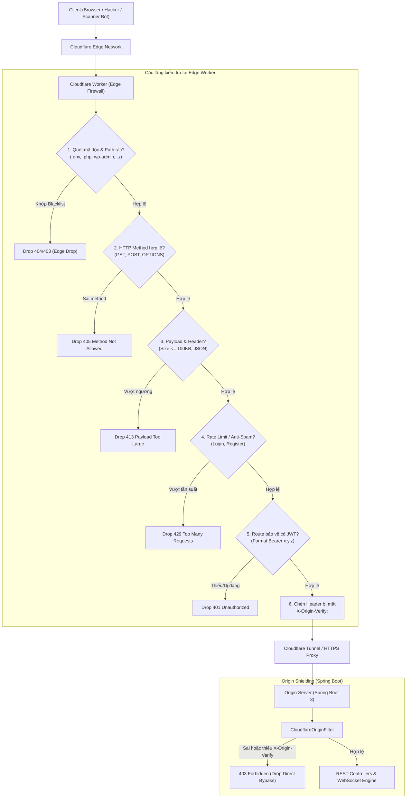

# Kế hoạch thiết kế và triển khai Tường lửa Cloudflare Worker (Edge Firewall)

## 1. Tổng quan & Lý do thiết kế

Khi triển khai Webgame Cờ Tỷ Phú từ máy cá nhân hoặc máy chủ LAN ra ngoài Internet (thông qua Port Forwarding hoặc Cloudflare Tunnel), máy chủ backend (Spring Boot 3 + PostgreSQL) sẽ phải đối mặt với lưu lượng truy cập công cộng.

Trên Internet, hàng nghìn botnet và scanner tự động liên tục rà quét toàn dải IP để tìm kiếm:
- Các file cấu hình nhạy cảm (`.env`, `.git/config`, `docker-compose.yml`).
- Lỗ hổng PHP/CMS phổ biến (`wp-admin`, `phpmyadmin`, `xmlrpc.php`).
- Spring Boot Actuator hoặc các endpoint quản trị mở hớ hênh.
- Brute-force mật khẩu đăng nhập hoặc flood WebSocket handshake gây tràn bộ nhớ (DoS).

Nếu để tất cả các request này chạm trực tiếp vào Spring Boot, server sẽ bị lãng phí CPU, RAM (khởi tạo thread pool, kết nối JDBC, parse JSON rác) và băng thông mạng gia đình.

**Giải pháp**: Thiết lập một **Cloudflare Worker** hoạt động như một **Edge Reverse Proxy & Tường lửa (Edge Firewall)** đứng trước backend. Toàn bộ request từ Internet buộc phải đi qua Cloudflare Edge Network (hơn 300 trung tâm dữ liệu toàn cầu). Tường lửa Worker sẽ phân tích, thanh lọc và **drop (từ chối ngay lập tức)** các request không hợp lệ trong vài milli-giây với chi phí tài nguyên backend bằng 0.

---

## 2. Kiến trúc luồng xử lý (Architecture & Traffic Flow)



---

## 3. Danh mục các quy tắc Drop Request (Firewall Inspection Rules)

### 3.1. Quy tắc 1: Path Filtering & Bot Scanner Drop (Lọc đường dẫn)
- **Path Whitelist**: Chỉ cho phép các tiền tố hợp lệ:
  - `/api/**`: Các REST API của game.
  - `/ws/**` hoặc `/socket.io/**`: WebSocket handshake endpoint.
  - `/health`: Health check endpoint.
  - Các static assets nếu phục vụ web client (hoặc định tuyến qua Cloudflare Pages).
- **Scanner Blacklist**: Drop ngay tức khắc (HTTP 404 hoặc 403, không trả body dài) khi URL chứa:
  - Tệp nhạy cảm: `.*` (`.env`, `.git`, `.htaccess`, `.ds_store`, `.vscode`).
  - Đuôi mã nguồn web server khác: `*.php`, `*.asp`, `*.aspx`, `*.jsp`, `*.cgi`.
  - Endpoint quản trị phổ biến: `wp-login`, `wp-admin`, `xmlrpc`, `phpmyadmin`, `adminer`, `boaform`, `setup.cgi`, `telescope`.
  - Tấn công Path Traversal: `..`, `%2e%2e`, `/etc/passwd`.

### 3.2. Quy tắc 2: HTTP Method Filtering (Lọc phương thức)
- Game API trong phạm vi MVP chỉ sử dụng:
  - `GET`: Lấy thông tin user, phòng chơi, health check.
  - `POST`: Đăng ký, đăng nhập, tạo phòng, tham gia/rời phòng, bắt đầu ván.
  - `OPTIONS`: Phục vụ CORS Preflight Request từ trình duyệt.
- Toàn bộ các HTTP method khác (`PUT`, `DELETE`, `PATCH`, `TRACE`, `CONNECT`, `HEAD`) đều bị **drop 405 (Method Not Allowed)** tại Edge.

### 3.3. Quy tắc 3: Payload Size & Header Sanitization (Giới hạn kích thước)
- **Giới hạn kích thước body**: DTO của Webgame Cờ Tỷ Phú chỉ là các command hoặc auth form nhỏ (vài chục bytes đến tối đa vài KB).
  - Bất kỳ request nào có `Content-Length > 102400` (100 KB) sẽ bị drop ngay với **413 Payload Too Large** để chống tràn bộ nhớ backend.
- **Content-Type Validation**: Với các request `POST` vào `/api/**`, bắt buộc `Content-Type` phải chứa `application/json`. Nếu gửi `application/x-www-form-urlencoded` lạ hoặc multipart không mong muốn, drop ngay **415 Unsupported Media Type**.
- **User-Agent Filtering**: Drop các request không có header `User-Agent` hoặc có `User-Agent` từ các công cụ scan tấn công đã biết (`sqlmap`, `nikto`, `masscan`, `zgrab`, `nmap`).

### 3.4. Quy tắc 4: Pre-validation JWT Token ở Edge (Kiểm tra hình thức Token)
- Với các endpoint thuộc nhóm yêu cầu đăng nhập (ví dụ: `/api/rooms/**`, `/api/game/**`):
  - Kiểm tra sự tồn tại của header `Authorization: Bearer <token>`.
  - Kiểm tra cấu trúc chuẩn của JWT (gồm đúng 3 phần ngăn cách bởi dấu chấm `header.payload.signature` chuẩn Base64Url).
  - Nếu thiếu header hoặc token dị dạng rác, Worker phản hồi ngay **401 Unauthorized** mà không cần chuyển tiếp về Spring Boot để giải mã.

### 3.5. Quy tắc 5: Rate Limiting & Anti-Spam (Chống brute-force)
- Các endpoint nhạy cảm bị hạn chế tần suất gọi từ 1 IP:
  - Đăng ký (`/api/auth/register`): Tối đa 5 lần/phút/IP.
  - Đăng nhập (`/api/auth/login`): Tối đa 10 lần/phút/IP.
  - Tạo phòng (`/api/rooms`): Tối đa 10 lần/phút/IP.
- Vượt quá ngưỡng sẽ bị chặn với mã trạng thái **429 Too Many Requests**.

### 3.6. Quy tắc 6: Bảo vệ Origin Server (Origin Shielding)
- **Vấn đề**: Kẻ tấn công nếu dò ra IP thật của máy chủ (Origin IP) có thể gửi request trực tiếp qua IP mà không đi qua Cloudflare Worker.
- **Giải pháp**:
  - Worker tự động chèn header bí mật: `X-Origin-Verify: <NGẪU_NHIÊN_DÀI_32_KÝ_TỰ>`.
  - Trên Spring Boot, cấu hình một Servlet Filter (`CloudflareOriginFilter`) ở vị trí đầu tiên trong chuỗi filter. Nếu request thiếu hoặc sai header này, Spring Boot trả về ngay **403 Forbidden** và đóng kết nối.

---

## 4. Mã nguồn Cloudflare Worker mẫu (`worker.ts`)

```typescript
/**
 * Cloudflare Worker Edge Firewall cho Webgame Cờ Tỷ Phú
 */

export interface Env {
  ORIGIN_URL: string;             // Ví dụ: https://origin.mygame.internal hoặc URL Tunnel
  ORIGIN_SECRET_KEY: string;      // Chuỗi secret chia sẻ giữa Worker và Spring Boot
  ENVIRONMENT: string;
}

// Regex phát hiện các path quét lỗ hổng và file rác
const MALICIOUS_PATH_REGEX = /(?:\.env|\.git|\.aws|\.htaccess|wp-|phpmyadmin|xmlrpc|telescope|\.php|\.asp|\.jsp|cgi-bin|boaform|\.\.\/)/i;

// Regex phát hiện bot scanner đã biết
const MALICIOUS_UA_REGEX = /(?:sqlmap|nikto|nmap|masscan|zgrab|acunetix|havij)/i;

// Regex kiểm tra cấu trúc JWT (3 phần base64url)
const JWT_FORMAT_REGEX = /^Bearer\s+[A-Za-z0-9-_=]+\.[A-Za-z0-9-_=]+\.[A-Za-z0-9-_.+/=]+$/;

// Danh sách các HTTP Method được phép
const ALLOWED_METHODS = new Set(['GET', 'POST', 'OPTIONS']);

export default {
  async fetch(request: Request, env: Env, ctx: ExecutionContext): Promise<Response> {
    const url = new URL(request.url);
    const path = url.pathname;
    const method = request.method.toUpperCase();

    // 1. Xử lý CORS Preflight (OPTIONS)
    if (method === 'OPTIONS') {
      return handleCorsPreflight(request);
    }

    // 2. Lọc HTTP Method
    if (!ALLOWED_METHODS.has(method)) {
      return new Response(JSON.stringify({ error: 'METHOD_NOT_ALLOWED', message: 'Method không được hỗ trợ' }), {
        status: 405,
        headers: { 'Content-Type': 'application/json' },
      });
    }

    // 3. Drop các Path quét mã độc (Malicious Path / Scanner Drop)
    if (MALICIOUS_PATH_REGEX.test(path) || path.includes('//')) {
      console.warn(`[FIREWALL DROP] Blocked suspicious path: ${path} from ${request.headers.get('CF-Connecting-IP')}`);
      return new Response('Not Found', { status: 404 });
    }

    // 4. Kiểm tra User-Agent
    const userAgent = request.headers.get('User-Agent') || '';
    if (!userAgent || MALICIOUS_UA_REGEX.test(userAgent)) {
      return new Response('Forbidden', { status: 403 });
    }

    // 5. Kiểm tra tiền tố Path hợp lệ (Path Whitelisting)
    const isApi = path.startsWith('/api/');
    const isWs = path.startsWith('/ws') || path.startsWith('/socket.io');
    const isHealth = path === '/health';

    if (!isApi && !isWs && !isHealth && path !== '/') {
      return new Response('Route not found', { status: 404 });
    }

    // 6. Kiểm tra giới hạn kích thước Payload (Content-Length)
    const contentLength = parseInt(request.headers.get('Content-Length') || '0', 10);
    if (contentLength > 102400) { // 100 KB
      return new Response(JSON.stringify({ error: 'PAYLOAD_TOO_LARGE', message: 'Kích thước dữ liệu vượt quá 100KB' }), {
        status: 413,
        headers: { 'Content-Type': 'application/json' },
      });
    }

    // 7. Bắt buộc Content-Type application/json cho POST API
    if (isApi && method === 'POST') {
      const contentType = request.headers.get('Content-Type') || '';
      if (!contentType.toLowerCase().includes('application/json')) {
        return new Response(JSON.stringify({ error: 'UNSUPPORTED_MEDIA_TYPE', message: 'Content-Type phải là application/json' }), {
          status: 415,
          headers: { 'Content-Type': 'application/json' },
        });
      }
    }

    // 8. Pre-validation JWT Token tại Edge cho các route yêu cầu xác thực
    const isProtectedApi = path.startsWith('/api/rooms') || path.startsWith('/api/game');
    if (isProtectedApi) {
      const authHeader = request.headers.get('Authorization');
      if (!authHeader || !JWT_FORMAT_REGEX.test(authHeader)) {
        return new Response(JSON.stringify({ error: 'UNAUTHORIZED', message: 'Token xác thực không hợp lệ hoặc bị thiếu' }), {
          status: 401,
          headers: { 'Content-Type': 'application/json' },
        });
      }
    }

    // 9. Xử lý WebSocket Handshake
    if (isWs) {
      const upgradeHeader = request.headers.get('Upgrade');
      if (!upgradeHeader || upgradeHeader.toLowerCase() !== 'websocket') {
        return new Response('Expected WebSocket upgrade', { status: 426 });
      }
    }

    // 10. Chuyển tiếp Request tới Origin kèm Secret Header (Origin Shielding)
    const originUrl = new URL(path + url.search, env.ORIGIN_URL);
    const newHeaders = new Headers(request.headers);
    newHeaders.set('X-Origin-Verify', env.ORIGIN_SECRET_KEY);
    newHeaders.set('X-Forwarded-For', request.headers.get('CF-Connecting-IP') || '');
    newHeaders.set('X-Forwarded-Proto', 'https');

    try {
      const originResponse = await fetch(originUrl.toString(), {
        method: request.method,
        headers: newHeaders,
        body: request.body,
        redirect: 'manual',
      });

      // Tạo response trả về cho client kèm CORS headers
      const responseHeaders = new Headers(originResponse.headers);
      responseHeaders.set('Access-Control-Allow-Origin', '*');
      responseHeaders.set('X-Edge-Protected-By', 'Cloudflare-Worker-Firewall');

      return new Response(originResponse.body, {
        status: originResponse.status,
        statusText: originResponse.statusText,
        headers: responseHeaders,
      });
    } catch (err: any) {
      console.error(`[ORIGIN ERROR] Failed to connect to origin: ${err.message}`);
      return new Response(JSON.stringify({ error: 'BAD_GATEWAY', message: 'Không thể kết nối đến máy chủ game' }), {
        status: 502,
        headers: { 'Content-Type': 'application/json' },
      });
    }
  },
};

function handleCorsPreflight(request: Request): Response {
  return new Response(null, {
    status: 204,
    headers: {
      'Access-Control-Allow-Origin': '*',
      'Access-Control-Allow-Methods': 'GET, POST, OPTIONS',
      'Access-Control-Allow-Headers': 'Content-Type, Authorization, X-Requested-With',
      'Access-Control-Max-Age': '86400',
    },
  });
}
```

---

## 5. Cấu hình Origin Shielding trên Spring Boot (`CloudflareOriginFilter.java`)

Để bảo đảm an toàn tuyệt đối, Spring Boot cài đặt filter xác thực header:

```java
package com.ptit.monopoly.security;

import jakarta.servlet.FilterChain;
import jakarta.servlet.ServletException;
import jakarta.servlet.http.HttpServletRequest;
import jakarta.servlet.http.HttpServletResponse;
import org.springframework.beans.factory.annotation.Value;
import org.springframework.core.Ordered;
import org.springframework.core.annotation.Order;
import org.springframework.stereotype.Component;
import org.springframework.web.filter.OncePerRequestFilter;

import java.io.IOException;

/**
 * Filter đứng đầu chuỗi bảo mật, chỉ cho phép traffic chuyển tiếp từ Cloudflare Worker.
 */
@Component
@Order(Ordered.HIGHEST_PRECEDENCE)
public class CloudflareOriginFilter extends OncePerRequestFilter {

    @Value("${app.security.origin-secret:}")
    private String expectedSecret;

    @Value("${app.security.origin-protection-enabled:false}")
    private boolean isProtectionEnabled;

    @Override
    protected void doFilterInternal(HttpServletRequest request,
                                    HttpServletResponse response,
                                    FilterChain filterChain) throws ServletException, IOException {
        
        // Nếu ở môi trường local test thì có thể disable cờ này qua application.properties
        if (!isProtectionEnabled) {
            filterChain.doFilter(request, response);
            return;
        }

        String receivedSecret = request.getHeader("X-Origin-Verify");

        if (receivedSecret == null || !receivedSecret.equals(expectedSecret)) {
            response.setStatus(HttpServletResponse.SC_FORBIDDEN);
            response.setContentType("application/json");
            response.getWriter().write("{\"error\": \"DIRECT_ACCESS_BLOCKED\", \"message\": \"Direct access to origin server is forbidden.\"}");
            return;
        }

        filterChain.doFilter(request, response);
    }
}
```

---

## 6. Lộ trình triển khai & Kịch bản kiểm thử (Verification & Test Cases)

### 6.1. Các bước triển khai (Deployment Steps)
1. **Khởi tạo project Cloudflare Worker**:
   - Sử dụng công cụ `wrangler`: `npx wrangler init cloudflare-firewall`.
   - Cấu hình file `wrangler.toml` gồm các biến môi trường `ORIGIN_URL` và secret `ORIGIN_SECRET_KEY` (lưu bằng `wrangler secret put ORIGIN_SECRET_KEY`).
2. **Cấu hình kết nối Origin**:
   - Khuyến nghị sử dụng **Cloudflare Tunnel (`cloudflared`)** trên máy chủ:
     - Không cần mở port trên router nhà mạng (không cần NAT/Port Forwarding).
     - Địa chỉ IP thật của máy chủ hoàn toàn ẩn danh khỏi Internet.
     - Cloudflare Worker proxy trực tiếp vào hostname của Tunnel.
3. **Kích hoạt `CloudflareOriginFilter` trên Spring Boot**:
   - Cập nhật biến môi trường `ORIGIN_SECRET_KEY` trong `application-prod.properties`.
4. **Deploy Worker lên Cloudflare Edge**:
   - Chạy lệnh `npx wrangler deploy`.

### 6.2. Kịch bản kiểm thử Drop Request (Test Cases)

| STT | Kịch bản kiểm thử | Lệnh test (curl) | Kết quả mong đợi |
|---|---|---|---|
| 1 | Quét file `.env` nhạy cảm | `curl -i https://game.example.com/.env` | **404 Not Found** (Drop ngay tại Edge Worker) |
| 2 | Quét bot WordPress | `curl -i https://game.example.com/wp-login.php` | **404 Not Found** (Drop ngay tại Edge Worker) |
| 3 | Tấn công Path Traversal | `curl -i https://game.example.com/api/../../etc/passwd` | **404 Not Found** (Drop ngay tại Edge Worker) |
| 4 | Gửi HTTP Method lạ (DELETE/PUT) | `curl -i -X DELETE https://game.example.com/api/rooms` | **405 Method Not Allowed** |
| 5 | Gửi User-Agent từ tool scanner | `curl -i -A "sqlmap/1.5" https://game.example.com/api/rooms` | **403 Forbidden** |
| 6 | Gửi Body quá 100KB | `curl -i -X POST -H "Content-Type: application/json" -d @large_file.json https://game.example.com/api/rooms` | **413 Payload Too Large** |
| 7 | Gửi sai Content-Type (POST) | `curl -i -X POST -H "Content-Type: text/plain" -d "hello" https://game.example.com/api/rooms` | **415 Unsupported Media Type** |
| 8 | Truy cập endpoint bảo vệ thiếu JWT | `curl -i https://game.example.com/api/rooms/create` | **401 Unauthorized** (Drop ngay tại Edge) |
| 9 | Request hợp lệ có JWT chuẩn | `curl -i -H "Authorization: Bearer <valid_jwt>" https://game.example.com/api/rooms` | **200 OK** (Được chuyển tiếp tới Spring Boot) |
| 10 | Truy cập trực tiếp IP Origin (Bypass Cloudflare) | `curl -i http://<ORIGIN_IP>:8080/api/rooms` | **403 Forbidden** (Bị Spring Boot `CloudflareOriginFilter` chặn) |

---

## 7. Tiêu chí hoàn thành (Acceptance Criteria)

1. Tường lửa Cloudflare Worker drop thành công 100% các request rác, path scanner, malformed payload và scanner bot trước khi request chạm vào máy chủ Spring Boot.
2. Máy chủ backend duy trì mức tải CPU và RAM ổn định ngay cả khi đang bị quét scan từ Internet.
3. Độ trễ (latency overhead) do Cloudflare Worker thêm vào dưới 15ms đối với người dùng trong nước.
4. Cơ chế Origin Shielding chặn hoàn toàn truy cập trực tiếp vào IP server khi không có secret token `X-Origin-Verify`.
5. WebSocket kết nối mượt mà, hỗ trợ đầy đủ các bản tin STOMP giữa React client và Spring Boot server.
