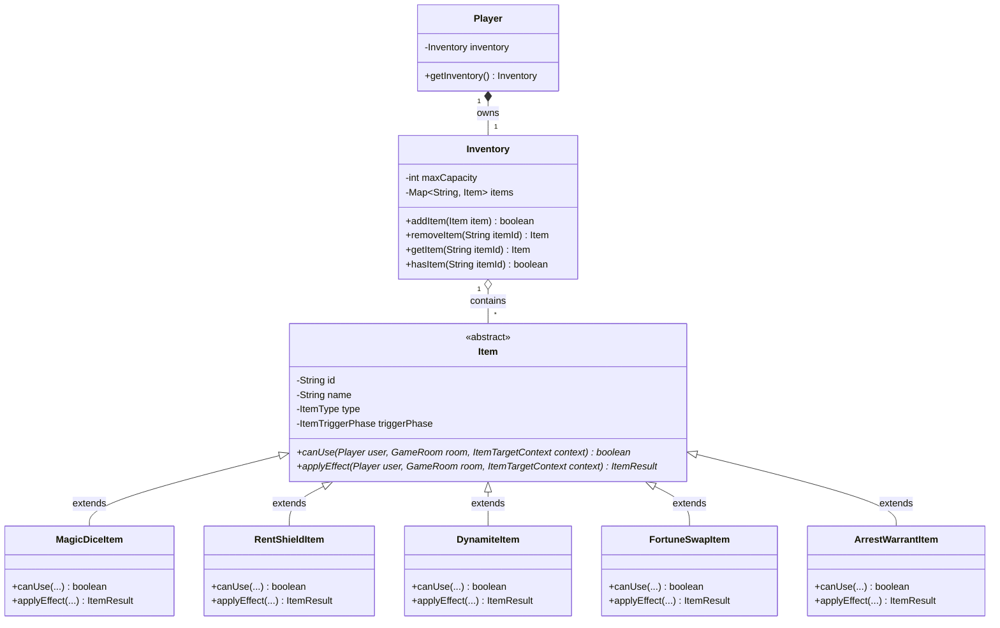
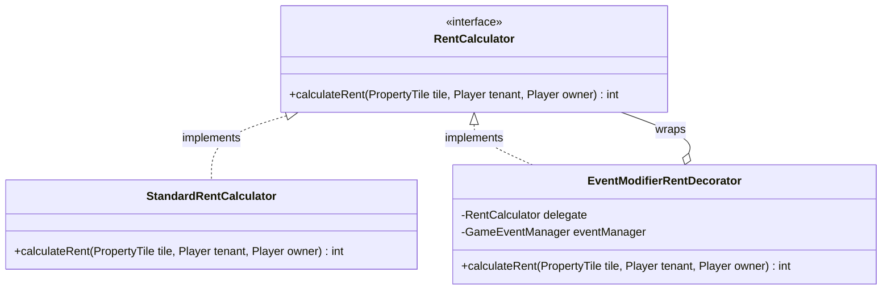
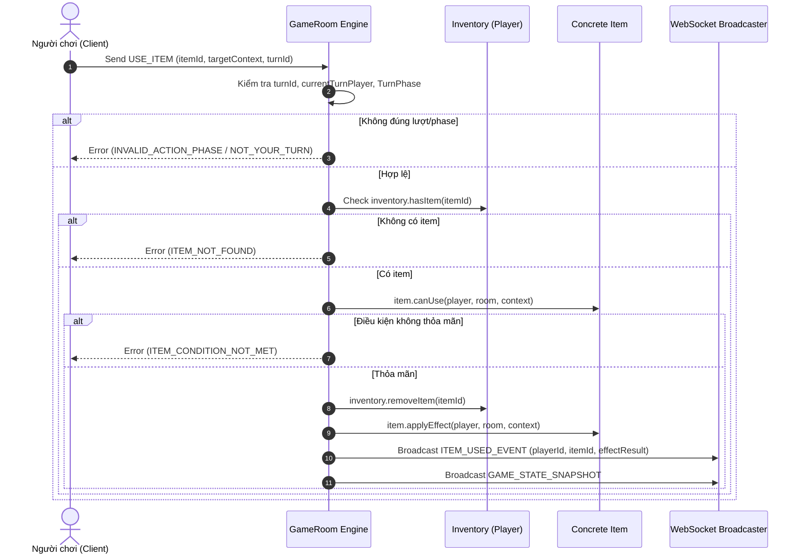
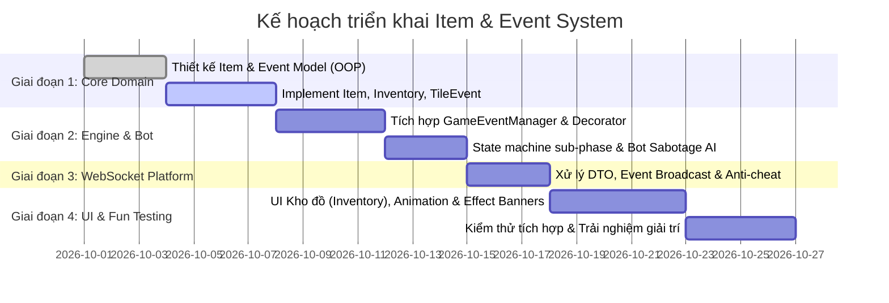

# Kế hoạch triển khai Hệ thống Vật phẩm và Sự kiện Đặc biệt (Party Mode)

## 1. Tổng quan & Triết lý thiết kế

Tài liệu này xác định kiến trúc, mô hình hướng đối tượng (OOP) và lộ trình triển khai hai tính năng cốt lõi tạo nên trải nghiệm chơi đặc trưng của Webgame Cờ Tỷ Phú:
1. **Hệ thống Vật phẩm (Item & Inventory System)**: Người chơi thu thập, sở hữu và kích hoạt các vật phẩm chiến thuật mang tính tương tác cao để "troll" nhau, lật kèo và tạo bất ngờ.
2. **Hệ thống Sự kiện Đặc biệt (Special Event System)**: Các sự kiện mang tính toàn cục (Global Events) hoặc cục bộ (Tile Events) diễn ra theo chu kỳ hoặc ngẫu nhiên, tạo nên các biến số hỗn loạn và kịch tính.

### Định hướng & Triết lý thiết kế
- **Mục đích vui là chính (Chaotic Party Game)**: Không đặt nặng việc cân bằng chỉ số (game balance) quá khắt khe hay tính cạnh tranh thể thao điện tử (esports). Trọng tâm là sự vui vẻ, tiếng cười, các pha "bẻ lái", "hút máu" và lật kèo ngoạn mục giữa bạn bè.
- **Tích hợp mặc định (Bỏ chế độ Classic)**: Trò chơi mặc định chạy với đầy đủ hệ thống Vật phẩm và Sự kiện Đặc biệt mà không cần chia tách thành các chế độ chơi riêng biệt (`CLASSIC` vs `EXPANDED`). Mọi người chơi vào bàn đều có kho đồ và tham gia vào vòng quay sự kiện.
- **Server Authoritative & Anti-cheat**: Dù game vui vẻ hỗn loạn, backend Spring Boot vẫn kiểm soát 100% logic để đảm bảo không bị hack/cheat, state nhất quán và không phát sinh bug logic. Client chỉ gửi command và nhận snapshot/event để diễn hoạt animation.
- **Vận dụng 4 tính chất OOP & Design Patterns**:
  - **Abstraction & Polymorphism**: `abstract class Item` và `abstract class GameEvent` là nền tảng. Game engine chỉ cần gọi `item.applyEffect(...)` hoặc `event.onTrigger(...)` mà không cần biết cụ thể đó là vật phẩm gì.
  - **Encapsulation**: Kho đồ `Inventory` nằm trọn trong `Player`, chỉ thao tác qua các method nghiệp vụ (`addItem`, `consumeItem`, `hasItem`).
  - **Design Patterns**:
    - `Strategy Pattern`: Xử lý thuật toán hiệu ứng vật phẩm và bot AI phản xạ dùng đồ.
    - `Decorator Pattern`: Biến đổi linh hoạt công thức tính tiền thuê (`RentCalculator`), tiền phạt, hoặc tiền thưởng khi chịu hiệu ứng của sự kiện.
    - `Observer Pattern`: Lắng nghe các mốc sự kiện vòng đời (`onTurnStart`, `onTurnEnd`, `onLandOnTile`, `onPassGo`) để kích hoạt sự kiện hoặc trừ thời gian hiệu lực.
    - `Factory Pattern`: Sinh ngẫu nhiên vật phẩm và sự kiện vui nhộn từ rương hoặc vòng quay.

---

## 2. Hệ thống Vật phẩm Hỗn loạn (Party Items)

### 2.1. Phân loại vật phẩm

Vật phẩm được chia làm 3 nhóm theo thời điểm và phương thức kích hoạt:

| Nhóm | Thời điểm kích hoạt (Trigger Phase) | Mục tiêu tác động (Target) | Mục đích trải nghiệm |
|---|---|---|---|
| **Active - Pre-Roll** | Trước khi gieo xúc xắc (`PRE_ROLL`) | Bản thân / Xúc xắc | Tự quyết định số phận, né ô nguy hiểm hoặc nhắm thẳng vào ô ngon |
| **Reactive - On-Land** | Khi dừng tại ô cờ (`RESOLVING_ACTION`) | Bản thân / Chủ đất | Cứu mạng vào phút chót, miễn nợ, "quay xe" |
| **Targeted - Sabotage** | Trong lượt chơi (`AWAITING_DECISION`) | Đối thủ / Ô cờ bất kỳ | Troll đối thủ, phá hoại tài sản, san bằng khoảng cách giàu nghèo |

### 2.2. Danh mục vật phẩm đề xuất (Vui nhộn & Đột biến cao)

1. **Xúc xắc Thần kỳ (Magic Dice)**: Chọn chính xác số bước đi từ 2 đến 12 thay vì gieo xúc xắc ngẫu nhiên.
2. **Khiên Hộ mệnh (Rent Shield)**: Miễn 100% tiền thuê khi dẫm vào ô đất có khách sạn của đối thủ.
3. **Cưỡng chế Thu mua (Hostile Takeover)**: Mua đứt 1 ô đất bất kỳ của đối thủ với giá niêm yết (không cần chủ đất đồng ý).
4. **Vỏ chuối Vô duyên (Banana Peel - Trap)**: Đặt bẫy tại 1 ô cờ bất kỳ. Nạn nhân dẫm phải sẽ bị trượt lùi 3 ô hoặc té ngã vào Nhà tù gần nhất.
5. **Thùng Thuốc nổ (Dynamite)**: Thổi bay toàn bộ nhà/khách sạn trên 1 ô đất chỉ định của đối thủ về lại đất trống.
6. **Lệnh Bắt Khẩn cấp (Arrest Warrant)**: Chỉ định 1 người chơi bất kỳ và tống thẳng người đó vào tù mà không cần qua ô GO.
7. **Gậy Đổi Vận (Fortune Swap)**: Hoán đổi vị trí trên bàn cờ với người chơi có tài sản cao nhất.
8. **Cướp cạn Robin Hood (Highway Robbery)**: Cướp ngay 30% tiền mặt của người giàu nhất bàn cờ và chia đều cho những người còn lại.

### 2.3. Thiết kế OOP cho Vật phẩm



#### Cấu trúc lớp Item trong Java

```java
public enum ItemTriggerPhase {
    PRE_ROLL,          // Trước khi gieo xúc xắc
    ON_LAND,           // Khi vừa dừng chân tại ô
    AWAITING_DECISION  // Trong pha tự do đưa ra quyết định
}

public abstract class Item {
    private final String id;
    private final String name;
    private final String description;
    private final ItemTriggerPhase triggerPhase;

    protected Item(String id, String name, String description, ItemTriggerPhase triggerPhase) {
        this.id = id;
        this.name = name;
        this.description = description;
        this.triggerPhase = triggerPhase;
    }

    public abstract boolean canUse(Player user, GameRoom room, ItemTargetContext context);
    public abstract ItemResult applyEffect(Player user, GameRoom room, ItemTargetContext context);

    public String getId() { return id; }
    public String getName() { return name; }
    public String getDescription() { return description; }
    public ItemTriggerPhase getTriggerPhase() { return triggerPhase; }
}
```

### 2.4. Cơ chế nhận vật phẩm trong ván đấu

- **Ô Rương Kho Báu / Ô May Mắn**: Khi dừng vào ô này, người chơi nhận ngay 1 vật phẩm ngẫu nhiên.
- **Thưởng Vòng Cờ (Lap Bonus)**: Mỗi khi đi qua ô GO, ngoài tiền mặt được tặng thêm 1 hộp quà chứa vật phẩm ngẫu nhiên.
- **Hòm Cứu Trợ Kẻ Nghèo**: Người chơi có tài sản thấp nhất sau mỗi 5 vòng đấu được hệ thống tặng miễn phí 1 vật phẩm cấp cao để tạo cơ hội lật kèo.

---

## 3. Hệ thống Sự kiện Đặc biệt (Special Event System)

### 3.1. Phân loại sự kiện giải trí

Sự kiện được kích hoạt theo chu kỳ (mỗi 4 - 5 vòng chơi) hoặc kích hoạt ngẫu nhiên khi dừng vào các ô đặc biệt:

```
                      +-------------------+
                      |     GameEvent     |
                      +---------+---------+
                                |
             +------------------+------------------+
             |                                     |
   +---------v---------+                 +---------v---------+
   |    GlobalEvent    |                 |     TileEvent     |
   | (Toàn cục bàn cờ) |                 | (Cục bộ ô cờ/vùng)|
   +-------------------+                 +-------------------+
   - Thuế nhà giàu 40%                   - Động đất sập nhà
   - Cơn sốt đất x3                      - Bão đóng băng ô
   - Đảo lộn đất đai                     - Trọng lực kỳ dị
```

#### 1. Sự kiện toàn cục (Global Periodic Events)
- **Thuế Nhà Giàu Siêu Cấp**: Người chơi giàu nhất bàn phải nộp ngay 40% tiền mặt chia đều cho những người chơi khác.
- **Cơn Điên Bất Động Sản**: Tất cả tiền thuê đất trên toàn bàn cờ nhân 3 lần trong vòng 3 lượt tiếp theo.
- **Đảo Lộn Đất Đai (Continental Drift)**: Hệ thống tự động tráo đổi quyền sở hữu của 2 ô đất ngẫu nhiên giữa 2 người chơi khác nhau.
- **Bắt Cóc Người Ngoài Hành Tinh (Alien Abduction)**: Người đang dẫn đầu ván chơi bị UFO bốc thẳng vào Nhà tù 2 lượt.
- **Ngày Phát Tiền Cứu Trợ (Stimulus Day)**: Ngân hàng giải ngân phát cho mỗi người chơi $500 tiêu vặt.

#### 2. Sự kiện cục bộ (Tile & Environmental Events)
- **Động Đất Cục Bộ**: 1 khu phố ngẫu nhiên bị chấn động, mỗi ô bị sập 1 cấp nhà.
- **Mưa Bão Đóng Băng**: 3 ô cờ liên tiếp bị đóng băng, người chơi đi qua hay dừng lại đều không mất tiền thuê nhưng bị bỏng lạnh trượt thêm 2 bước.
- **Hố Đen Vũ Trụ (Wormhole Tile)**: Ô cờ ngẫu nhiên biến thành cổng không gian, hút bất kỳ ai dừng lại sang vị trí đối diện của bàn cờ.

### 3.2. Thiết kế OOP cho Sự kiện (Observer & Decorator)

Sự kiện tác động vào cách tính tiền thuê (`Rent calculation`) và tiền thưởng thông qua **Decorator Pattern**:



#### Quản lý vòng đời sự kiện: `GameEventManager`

```java
public class GameEventManager {
    private final List<ActiveEventInstance> activeEvents = new ArrayList<>();

    public void onTurnStart(GameRoom room, Player currentPlayer) {
        Iterator<ActiveEventInstance> iterator = activeEvents.iterator();
        while (iterator.hasNext()) {
            ActiveEventInstance instance = iterator.next();
            instance.decrementDuration();
            if (instance.isExpired()) {
                instance.getEvent().onExpire(room);
                iterator.remove();
                room.broadcastEvent(new EventExpiredNotification(instance.getEvent().getId()));
            }
        }
    }

    public void triggerEvent(GameEvent event, GameRoom room) {
        ActiveEventInstance instance = new ActiveEventInstance(event, event.getDefaultDuration());
        activeEvents.add(instance);
        event.onTrigger(room);
        room.broadcastEvent(new EventTriggeredNotification(event));
    }
}
```

---

## 4. Tích hợp Game Engine & Luồng Authoritative

### 4.1. Mở rộng State Machine

Quy trình lượt chơi tích hợp sẵn việc dùng vật phẩm:

```
[WAITING_ROLL]
      │
      ├──── Command: USE_ITEM (MagicDice) ───► Thiết lập số bước cố định
      │
      ▼
Command: ROLL_DICE
      │
      ▼
[MOVING_PLAYER]
      │
      ▼
[RESOLVING_TILE_ACTION]
      │
      ├──── Dẫm bẫy vỏ chuối ───────────────► Trượt lùi / vào tù ngay
      ├──── Dẫm đất đối thủ ────────────────► [AWAITING_REACTION] (Cơ hội dùng Khiên trong 8s)
      │
      ▼
[AWAITING_DECISION]
      │
      ├──── Command: USE_ITEM (Dynamite/Warrant/Swap)
      ├──── Command: BUY_PROPERTY
      │
      ▼
[END_TURN] ───► EventManager kiểm tra sự kiện & chuyển lượt
```

### 4.2. Luồng xử lý Server Authoritative cho Command dùng đồ



### 4.3. Xử lý Bot & Timeout với Vật phẩm

- **Bot Heuristic đơn giản (Vui là chính)**:
  - Khi dẫm đất đắt tiền: Dùng `RentShield` nếu có trong tay.
  - Khi có `MagicDice`: 70% chọn xúc xắc đi tới ô đất trống xịn nhất hoặc ô GO.
  - Khi có `Dynamite` hoặc `ArrestWarrant`: Luôn nhắm vào người chơi đang có nhiều tiền/tài sản nhất bàn để kéo top xuống.
  - Khi có `FortuneSwap`: Dùng ngay khi tài sản của mình kém người đứng đầu trên 50%.
- **Quy tắc Timeout & Anti-deadlock**:
  - Phase phản đòn (Reaction phase) cho phép người chơi kích hoạt Khiên chỉ kéo dài tối đa 8 giây. Hết 8 giây tự động trừ tiền thuê bình thường mà không làm nghẽn ván đấu.

---

## 5. Hợp đồng API & WebSocket Protocol

### 5.1. WebSocket Commands (Client -> Server)

#### 1. Sử dụng vật phẩm (`USE_ITEM`)
- **Destination**: `/app/room/{roomId}/use-item`
- **Payload**:
```json
{
  "turnId": 142,
  "itemId": "ITEM_DYNAMITE",
  "targetPlayerId": "player-2",
  "targetTileIndex": 24,
  "customParams": {}
}
```

#### 2. Kích hoạt Khiên phản đòn (`REACTION_USE_SHIELD`)
- **Destination**: `/app/room/{roomId}/react-shield`
- **Payload**:
```json
{
  "turnId": 142,
  "useShield": true
}
```

### 5.2. WebSocket Events (Server -> Client)

#### 1. Thông báo dùng vật phẩm thành công (`ITEM_USED`)
- **Topic**: `/topic/room/{roomId}`
- **Payload**:
```json
{
  "type": "ITEM_USED",
  "actorPlayerId": "player-1",
  "actorName": "Nobita",
  "itemId": "ITEM_FORTUNE_SWAP",
  "itemName": "Gậy Đổi Vận",
  "message": "Nobita đã dùng Gậy Đổi Vận để hoán đổi vị trí với Xeko!",
  "result": {
    "swappedWithPlayerId": "player-2",
    "newPosition": 35
  }
}
```

#### 2. Thông báo sự kiện xuất hiện (`SPECIAL_EVENT_TRIGGERED`)
- **Topic**: `/topic/room/{roomId}`
- **Payload**:
```json
{
  "type": "SPECIAL_EVENT_TRIGGERED",
  "eventId": "EVENT_ALIEN_ABDUCTION",
  "eventName": "Người Ngoài Hành Tinh Bắt Cóc",
  "description": "Người giàu nhất vừa bị UFO bốc thẳng vào Nhà tù 2 lượt!",
  "durationTurns": 2,
  "targetPlayerId": "player-2"
}
```

---

## 6. Kế hoạch triển khai theo giai đoạn & Phân công trách nhiệm

Hệ thống được thiết kế theo 4 giai đoạn nối tiếp:



### Phân công chi tiết theo 5 thành viên

| Thành viên | Trách nhiệm chính trong Module Item & Event | Sản phẩm bàn giao cụ thể |
|---|---|---|
| **Thành viên 1** (Phân tích & Thiết kế) | - Thiết kế kịch bản các hiệu ứng vật phẩm và sự kiện bựa/vui nhộn.<br>- Hoàn thiện Contract API cho `USE_ITEM` và các Event broadcast.<br>- Vẽ UML Class & Sequence Diagram cho Item/Event. | Danh sách mô tả kịch bản hiệu ứng, hợp đồng JSON schema, sơ đồ UML. |
| **Thành viên 2** (Core Domain) | - Implement `Inventory`, `abstract Item`, các lớp con vật phẩm.<br>- Implement `GameEvent`, `GlobalEvent`, `TileEvent`.<br>- Triển khai Decorator Pattern cho `RentCalculator`.<br>- Viết Unit Test cho từng hiệu ứng vật phẩm. | Package `com.monopoly.domain.item` và `com.monopoly.domain.event` cùng bộ test JUnit 5. |
| **Thành viên 3** (Game Engine & Bot) | - Tích hợp `GameEventManager` vào vòng đời `GameRoom`.<br>- Thêm phase phản đòn (`AWAITING_REACTION`) và xử lý action `USE_ITEM`.<br>- Cập nhật heuristic cho Bot biết dùng item "troll" người giàu nhất.<br>- Kiểm soát concurrency, tránh race condition khi timeout. | Package `engine` mở rộng, `BotSabotageStrategy`, concurrency tests. |
| **Thành viên 4** (Backend & WebSocket) | - Implement WebSocket controller tiếp nhận `USE_ITEM` command.<br>- Broadcast DTOs tương ứng cho client.<br>- Đảm bảo anti-cheat: kiểm tra sở hữu item, đúng lượt, đúng phase. | WebSocket Handlers, DTOs, Security Validation rules. |
| **Thành viên 5** (Frontend & Testing) | - Xây dựng component `InventoryModal` và khay chứa item trên giao diện.<br>- Hiển thị Banner sự kiện toàn màn hình với hiệu ứng âm thanh/chữ hài hước.<br>- Hiển thị icon bẫy vỏ chuối, bom nổ trên bàn cờ.<br>- Viết Integration Tests E2E kiểm tra luồng dùng đồ và kích hoạt sự kiện. | Component React: `PlayerInventory.tsx`, `EventBanner.tsx`, Cypress/Jest test suites. |

---

## 7. Tiêu chí nghiệm thu (Acceptance Criteria)

1. **Trải nghiệm hỗn loạn & Vui nhộn (Chaos & Fun)**:
   - Tất cả các vật phẩm và sự kiện có hiệu ứng rõ ràng, tác động tức thì lên cục diện bàn cờ.
   - Luôn có cơ hội lật kèo ngoạn mục cho người chơi đứng chót thông qua các vật phẩm như Gậy Đổi Vận, Cướp cạn Robin Hood hoặc sự kiện Thuế Nhà Giàu.
2. **Server Authoritative tuyệt đối**:
   - Client không thể hack hoặc giả mạo item mình không sở hữu.
   - Mọi command dùng đồ đều được server validate và broadcast công khai cho cả bàn cờ.
3. **Không treo ván đấu (Anti-deadlock)**:
   - Các phase phản đòn có countdown ngắn (8 giây), nếu người chơi không bấm hoặc mất kết nối thì server tự động bỏ qua và tiếp tục ván đấu.
   - Bot ra quyết định nhanh chóng (dưới 500ms), không làm chậm nhịp độ trận đấu.
4. **Chất lượng mã nguồn OOP**:
   - Tuân thủ đầy đủ 4 tính chất OOP (Trừu tượng, Kế thừa, Đa hình, Đóng gói) và các mẫu thiết kế Strategy, Decorator, Observer.
   - Thêm một vật phẩm mới chỉ cần tạo lớp kế thừa `Item` mà không cần sửa code cốt lõi của Game Engine.
